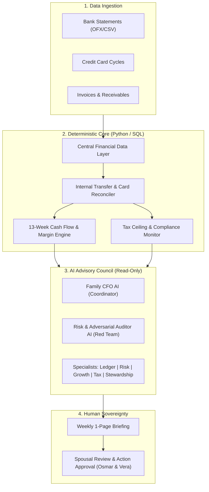

# OpenFamilyOffice

<p align="center">
  <strong>An open-source, multi-entity, lean family office & financial intelligence operating system for households, solopreneurs, MEIs, and small businesses worldwide.</strong>
</p>

<p align="center">
  <a href="LICENSE"></a>
  <a href="docs/EGM_DEVELOPMENT_SPEC.md"></a>
  <a href="ROADMAP.md"></a>
  <a href="#"></a>
  <a href="#"></a>
</p>

<p align="center">
  <a href="README.md"><strong>English</strong></a> &ensp;·&ensp;
  <a href="README.pt-BR.md"><strong>Português (Brasil)</strong></a> &ensp;·&ensp;
  <a href="README.es.md"><strong>Español</strong></a>
</p>

---

## What is OpenFamilyOffice?

Wealth management and corporate financial intelligence tools have historically been reserved for high-net-worth families (Private Family Offices) and large corporations (expensive ERPs). Meanwhile, solopreneurs, freelancers, and small business owners juggle disconnected personal spreadsheets, disjointed banking apps, and chaotic corporate cash flows.

Recent AI demos showcase "autonomous finance teams," but in the real world they fail due to **math hallucinations, lack of accounting reconciliation, conflation of personal and corporate funds, and ignorance of local tax laws**.

**OpenFamilyOffice** is built on a non-negotiable principle:

$$\Large \textbf{Deterministic Code Calculates} \quad \boldsymbol{+} \quad \textbf{AI Interprets}$$

1. **Deterministic Python/SQL algorithms** calculate cash runways, contribution margins, tax ceilings, and 13-week cash forecasts with 100% mathematical precision.
2. **A specialized AI Advisory Council** consumes verified data to detect anomalies, analyze qualitative trade-offs, stress-test risks, and produce a concise **1-page Weekly Executive Briefing** for family decision-makers.

---

## Key Pillars & Architectural Highlights

### 1. Multi-Entity Separation (Personal Household vs. Operating Businesses)
Strictly prevents commingling between personal finances (PF) and corporate ventures (PJ). Supports running multiple businesses in parallel (e.g., an established cash-flow service company alongside an early-stage validation venture) while rolling up consolidated net worth.

### 2. Tri-Perspective Accounting Engine
Financial reality cannot be captured by a single view. OpenFamilyOffice simultaneously calculates:
* **Cash Flow Perspective (Financeiro)**: Liquidity, bank balances, and rolling 13-week runway.
* **Managerial Accrual Perspective (Competência)**: Invoiced deliverables, direct job costs, and true unit profitability.
* **Balance Sheet Wealth Perspective (Patrimonial)**: Total assets, debt coverage, and inflation-adjusted purchasing power.

### 3. Financial Controller & Invariant Reconciler
* **Internal Transfer Neutralizer**: Pairs matching debit and credit transfers between household and business accounts, preventing artificial revenue/expense duplication.
* **Credit Card Reconciler**: Records purchases on transaction dates while treating statement payments as liability settlements, eliminating double-counted expenses.
* **Confidence Rating**: Tags every figure as `[CONFIRMED]`, `[ESTIMATED]`, or `[PENDING]`.

### 4. Spec-Driven Engineering via Google's Elephant-Goldfish Model (EGM)
OpenFamilyOffice is engineered using Google's open-source **[Elephant-Goldfish Model (EGM)](https://opensource.googleblog.com/2026/10/introducing-elephant-goldfish-model-plugin.html)** methodology:
* **The Elephant (Specification First)**: Context-rich architectural specifications (`docs/designs/`) maintain project memory and design intent before code is written.
* **The Goldfish (Adversarial Engineering Review)**: Stateless subagents audit specifications and pull requests without conversational bias, testing edge cases and legal constraints.

### 5. Brazilian Regulatory Depth & Global Modularity
* **Brazil Core**: Out-of-the-box support for Microempreendedor Individual (MEI) gross revenue ceilings under **Lei Complementar nº 238/2026** (R\$ 81k in 2026, R\$ 110k in 2027, R\$ 140k in 2028), DAS payment calendars, anti-partner registration audits, and Simples Nacional transition pathways.
* **Global Modularity**: Pluggable tax architecture for US Single-Member LLCs, UK Sole Traders, Spanish Autónomos, and European freelancers.

### 6. Human Sovereignty & Spousal Governance
* **No Autonomous Movement of Money**: The system NEVER executes bank transfers, signs contracts, or trades assets.
* **Dual-Key Approval**: Family principals (e.g., Osmar & Vera) establish discretionary spending limits and jointly approve major investments, price changes, and contracts.

### 7. Local-First Privacy (LGPD & GDPR Compliant)
Sensitive financial transactions and tax identifiers are protected locally with strict Modulo-11 and SHA-256 masking. Cloud LLMs receive only sanitized, redacted data.

### 8. Instant Receipt & NFC-e Photo Ingestion (Zero-Friction Mobile Capture)
Snap a photo of any supermarket receipt, hardware store slip, or fuel invoice:
* **Brazil NFC-e / SAT QR-Code Reader**: Instantly reads official SEFAZ fiscal QR codes, retrieving 100% exact itemized line items, unit prices, and seller CNPJ with zero OCR error.
* **Multimodal Vision AI Fallback**: Local OCR or cloud vision models extract items, taxes, payment method, and merchant from non-QR paper slips.
* **Anti-Duplication Card Matching**: Automatically detects if the receipt corresponds to a card transaction already logged on the statement, enriching the transaction with itemized details without duplicating the expense. See [`docs/RECEIPT_OCR_INGESTION_SPEC.md`](docs/RECEIPT_OCR_INGESTION_SPEC.md).

### 9. Multi-Provider Free-Tier LLM Router & Proactive Rate Limiting
Run OpenFamilyOffice at **\$0/month operating cost** using free-tier API quotas safely:
* **Sliding Window Tracking**: Proactively monitors rolling RPM (Requests Per Minute), TPM (Tokens Per Minute), and RPD (Requests Per Day).
* **Proactive Failover**: When reaching 80% capacity, the router automatically fails over to the next healthy provider (Gemini 2.0 Flash $\rightarrow$ Groq Llama 3.3 70B $\rightarrow$ OpenRouter $\rightarrow$ NVIDIA NIM) *before* hitting a 429 error.
* **Dual-Path Latency**: Zero wait time for interactive user chats; smooth background delay queue for batch tasks. See [`docs/LLM_RATE_LIMIT_AND_FALLBACK_SPEC.md`](docs/LLM_RATE_LIMIT_AND_FALLBACK_SPEC.md).

### 10. Real-Time Macroeconomic Grounding & Daily Financial News
Grounds AI advisory agents in verified, real-world economic reality rather than stale LLM training data:
* **Official Central Bank Integration (BCB/SGS)**: Daily automated extraction of Selic Meta, Dólar Comercial PTAX, and IPCA 12-month inflation using free, official public APIs with zero API keys.
* **Public Financial RSS Ingestion**: Scans Google News Business and economic feeds for breaking headlines regarding exchange rates, interest rates, stock market trends, and MEI tax laws.
* **Local Daily Caching**: Automatically caches the daily snapshot in `data/macro_cache/` to avoid redundant network calls. See [`docs/MACRO_NEWS_AND_MARKET_INTELLIGENCE_SPEC.md`](docs/MACRO_NEWS_AND_MARKET_INTELLIGENCE_SPEC.md).

### 11. Universal Custom Provider Registry (Anthropic & OpenAI Compatible)
Future-proof architecture allowing dynamic registration of any current or future LLM provider without touching code:
* **Multi-Protocol Support**: Seamlessly dispatches requests to both **Anthropic-Compatible** (`/v1/messages`) and **OpenAI-Compatible** (`/v1/chat/completions`) endpoints.
* **Automated .env Importer**: Instantly imports configured API keys from existing `.env` files via `python -m src.cli config import`.
* **Zero Lock-In**: Simply specify a `base_url`, `api_key`, `protocol`, and `model` to connect any enterprise proxy, custom cloud gateway, or local instance. See [`docs/CUSTOM_PROVIDERS_AND_COMPATIBILITY_SPEC.md`](docs/CUSTOM_PROVIDERS_AND_COMPATIBILITY_SPEC.md).

### 12. Curated Free Public APIs Suite (Finance, Crypto, CNPJ, Calendar)
Integrated with high-reliability, zero-auth public APIs from the [public-apis](https://github.com/public-apis/public-apis) ecosystem:
* **Currency & FX (AwesomeAPI & Frankfurter)**: Real-time USD, EUR, and GBP rates with bid/ask spreads and daily variations (`python -m src.cli market`).
* **Cryptocurrency (Coinbase Spot & AwesomeAPI)**: Real-time Bitcoin (BTC) and Ethereum (ETH) prices in BRL and USD without API keys.
* **Business & Vendor Intelligence (BrasilAPI CNPJ)**: Inspect any company/supplier legal standing (Ativa/Inapta), CNAE, and corporate partners QSA (`python -m src.cli cnpj <digits>`).
* **Banking Calendar & Settlement Dates (BrasilAPI Feriados & Nager.Date)**: Automatically calculates banking business days and rolls due dates for tax slips (DAS) and invoices falling on weekends or public holidays (`python -m src.cli holidays`). See [`docs/PUBLIC_APIS_INTEGRATION_SPEC.md`](docs/PUBLIC_APIS_INTEGRATION_SPEC.md).

---

## System Architecture



---

## The AI Advisory Council (7+1 Agent Suite)

| Agent | Core Responsibility | Anchor Question |
|---|---|---|
| **Family CFO AI** | Executive coordination, weekly briefing synthesis, decision prioritization. | *"What are the critical decisions we must make this week to protect cash and grow net worth?"* |
| **Financial Controller & Ledger Analyst** | Data hygiene, categorization, commingling detection, leak identification. | *"Where are the inconsistencies, leaks, and misclassified transactions across entities?"* |
| **Liquidity & Risk AI** | 13-week cash flow, emergency reserve runway, crisis stress-testing. | *"If revenue drops tomorrow, how many months do we survive, and what must be done today?"* |
| **Growth & Pricing AI** | Unit economics, pricing strategy, contribution margins, client concentration. | *"Which services or clients should we renegotiate or drop to increase profit without extra hours?"* |
| **Tax & Compliance AI** | MEI / LC 238 ceilings, DAS deadlines, legal corporate separation. | *"What upcoming fiscal deadlines or revenue limits could expose us to penalties or regime changes?"* |
| **Stewardship & Succession AI** | Asset shielding, legal firewalls, insurance matrices, estate continuity. | *"What legal, fiscal, or personal vulnerability could threaten our family if a crisis occurs?"* |
| **Risk & Adversarial Auditor AI** | Financial devil's advocate, attacks assumptions, fights confirmation bias. | *"Why is the Family CFO's proposed weekly plan fragile, flawed, or overly optimistic?"* |
| **[Future] Capital Allocation AI** | Long-term portfolio rebalancing, macro inflation hedging. | *"How should surplus capital be allocated across asset classes to preserve multi-generational wealth?"* |

---

## Repository Structure

```text
open-family-office/
├── .gemini/                       # Antigravity & EGM agent configuration & styleguide
│   ├── config.yaml
│   └── styleguide.md
├── docs/                          # Architectural specifications (EGM Hay Blueprints)
│   ├── PROJECT_CHARTER.md         # Vision, principles, scope, and boundaries
│   ├── FINANCIAL_DATA_ARCHITECTURE.md # Unified relational schema & tri-perspective model
│   ├── AI_GOVERNANCE.md           # Advisory council design, human sovereignty, LGPD
│   ├── EGM_DEVELOPMENT_SPEC.md    # Spec-Driven Development contracts & review loops
│   └── CRISIS_PLAYBOOK.md         # Quantitative triggers & contingency action plans
├── prompts/                       # Production prompt suite with structured JSON outputs
│   ├── README.md
│   ├── 01_family_cfo.md
│   ├── 02_financial_controller_ledger.md
│   ├── 03_liquidity_risk.md
│   ├── 04_growth_pricing.md
│   ├── 05_tax_compliance_mei.md
│   ├── 06_stewardship_succession.md
│   └── 07_adversarial_auditor.md
├── templates/                     # CSV input schemas and executive reporting templates
│   ├── README.md
│   ├── transactions_template.csv  # Standard ledger import format
│   ├── entities_template.csv      # Multi-entity configuration registry
│   ├── categories_template.csv    # Hierarchical chart of accounts
│   └── weekly_briefing_template.md# 1-page executive briefing template
├── CONTRIBUTING.md                # Open-source contribution guidelines
├── CODE_OF_CONDUCT.md             # Contributor Covenant Code of Conduct
├── LICENSE                        # MIT License
├── README.md                      # English documentation (this file)
├── README.pt-BR.md                # Brazilian Portuguese documentation
├── README.es.md                   # Spanish documentation
└── ROADMAP.md                     # Phased development milestones
```

---

## Quickstart & How to Use

### 1. Explore Architectural Contracts
Read the foundational specifications in `docs/`:
1. [`docs/PROJECT_CHARTER.md`](docs/PROJECT_CHARTER.md): Core mission, problem statement, and boundaries.
2. [`docs/FINANCIAL_DATA_ARCHITECTURE.md`](docs/FINANCIAL_DATA_ARCHITECTURE.md): Data schema, transfer rules, and accounting models.
3. [`docs/AI_GOVERNANCE.md`](docs/AI_GOVERNANCE.md): Agent protocols, spousal approval matrix, and privacy rules.

### 2. Prepare Your Financial Data
Copy and adapt the templates in `templates/`:
* Set up your household and business entities in `entities_template.csv`.
* Customize your chart of accounts in `categories_template.csv`.
* Export your bank/credit card transactions into `transactions_template.csv`.

### 3. Run CLI & AI Advisory Briefings
Execute the CLI commands for deterministic audits and AI advisory briefings:
```bash
# Run weekly executive briefing (Family CFO + Risk Red Team audit)
python -m src.cli briefing [--dry-run]

# Ingest receipt photo or Brazilian SEFAZ NFC-e QR Code
python -m src.cli receipt "https://www.nfce.fazenda.sp.gov.br/qrcode?p=..."
python -m src.cli receipt path/to/cupom.jpg

# Inspect live market FX, Crypto, Holidays, and CNPJ status
python -m src.cli market
python -m src.cli holidays
python -m src.cli cnpj 12345678000195

# Configure LLM providers or import keys from .env
python -m src.cli config list
python -m src.cli config import --source path/to/.env
```

---

## Roadmap

* **Phase 1 (Complete)**: Deterministic Core & Data Engine (Python data models, transfer neutralizer, card reconciler, runway math, MEI monitor).
* **Phase 2 (Complete)**: AI Advisory Suite CLI, Receipt Vision Ingestion & Automated Briefings (Multi-provider execution with Gemini, Groq, NVIDIA NIM, DeepSeek, BCB macro & Public APIs).
* **Phase 3 (Next)**: Interactive Web Dashboard & Mobile Ingestion (FastAPI + Modern UI, mobile camera upload, spousal approval UI).
* **Phase 4**: Multi-Agent Autonomous Orchestration & Global Tax Plugins (US, UK, Spain, Germany).

See the full [ROADMAP.md](ROADMAP.md) for detailed deliverables.

---

## Contributing

We welcome contributions from developers, accountants, tax specialists, and financial planners worldwide!
* Read [CONTRIBUTING.md](CONTRIBUTING.md) to get started.
* Review our [EGM Development Spec](docs/EGM_DEVELOPMENT_SPEC.md) to understand how we use Spec-Driven Development before submitting code.

---

## License

This project is open-source software licensed under the [MIT License](LICENSE).

