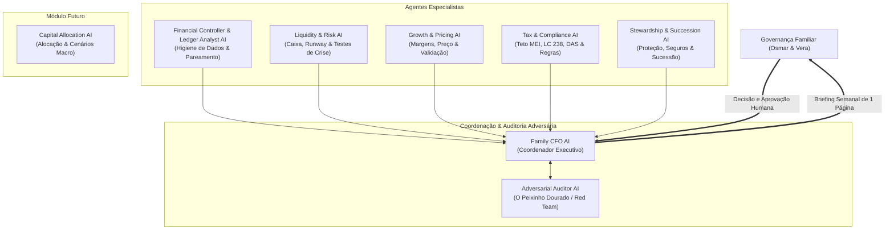

# OpenFamilyOffice

<p align="center">
  <strong>Sistema operacional open-source de inteligência financeira e family office enxuto para famílias, profissionais autônomos, MEIs e microempresas no Brasil e no mundo.</strong>
</p>

<p align="center">
  <a href="LICENSE"></a>
  <a href="docs/EGM_DEVELOPMENT_SPEC.md"></a>
  <a href="ROADMAP.md"></a>
  <a href="#"></a>
  <a href="#"></a>
</p>

<p align="center">
  <a href="README.md"><strong>English</strong></a> &ensp;·&ensp;
  <a href="README.pt-BR.md"><strong>Português (Brasil)</strong></a> &ensp;·&ensp;
  <a href="README.es.md"><strong>Español</strong></a>
</p>

---

## O que é o OpenFamilyOffice?

Historicamente, ferramentas de inteligência financeira de alto nível sempre foram privilégio exclusivo de famílias ultrarricas (Family Offices Privados) ou grandes corporações (ERPs caros como SAP e NetSuite). Na outra ponta, famílias empreendedoras, profissionais autônomos e donos de pequenas empresas equilibram planilhas pessoais isoladas, múltiplos aplicativos de banco e fluxos de caixa corporativos desorganizados.

Demos recentes de IA prometem "equipes autônomas de finanças", mas na prática falham por motivos graves: **alucinação matemática em cálculos de caixa, falta de conciliação bancária, mistura perigosa entre Pessoa Física e Jurídica (PF x PJ) e desconhecimento da legislação tributária real (como limites de MEI e regras do Simples Nacional)**.

O **OpenFamilyOffice** foi construído sob um princípio inegociável:

$$\Large \textbf{Código Determinístico Calcula} \quad \boldsymbol{+} \quad \textbf{IA Interpreta}$$

1. **Algoritmos determinísticos em Python/SQL** calculam runway (meses de sobrevivência), margens de contribuição, limites tributários e fluxo de caixa de 13 semanas com 100% de exatidão matemática.
2. **Um Conselho Consultivo de Agentes de IA especializados** consome esses dados verificados para detectar anomalias, analisar cenários de risco, sugerir precificação e gerar um **Briefing Executivo Semanal de 1 página** para orientar as decisões da família.

---

## Pilares Estratégicos & Destaques da Arquitetura

### 1. Separação Multi-Entidade Real (Casa x Empresas)
Elimina a confusão perigosa entre Pessoa Física (PF) e Pessoa Jurídica (PJ). Permite gerenciar simultaneamente as finanças do casal/casa e múltiplos negócios (por exemplo, uma empresa de serviços consolidada como a *Fix Serviços* e uma nova operação de validação como a *Facilita Vistorias*), consolidando o patrimônio líquido total da família.

### 2. Motor Contábil em Tri-Perspectiva
A realidade financeira não cabe em uma única visão. O sistema modela simultaneamente:
* **Perspectiva Financeira (Fluxo de Caixa / DFC)**: Dinheiro que realmente entrou e saiu; saldo em contas e runway de 13 semanas.
* **Perspectiva Gerencial (Competência / DRE)**: Serviços prestados no mês, custos diretos e margem de contribuição real por cliente.
* **Perspectiva Patrimonial (Balanço da Família)**: Ativos totais, cobertura de dívidas e patrimônio líquido real corrigido pela inflação.

### 3. Financial Controller & Conciliação Invariante
* **Neutralizador de Transferências Internas**: Pareia débitos e créditos entre contas do casal e das empresas (ex: retirada de pró-labore da Fix para a conta PF do Osmar), impedindo que transferências sejam contabilizadas falsamente como receitas ou despesas.
* **Conciliador de Cartão de Crédito**: Registra compras na data da transação (competência) e trata o pagamento da fatura bancária como liquidação de passivo, impedindo a duplicação de despesas.
* **Classificação de Confiança**: Rotula cada dado como `[CONFIRMED]` (conciliado em extrato), `[ESTIMATED]` (projetado com premissas documentadas) ou `[PENDING]` (pendente de revisão humana).

### 4. Desenvolvido com o Elephant-Goldfish Model (EGM) da Google
O projeto adota o modelo de desenvolvimento orientado a especificações (**[EGM](https://opensource.googleblog.com/2026/10/introducing-elephant-goldfish-model-plugin.html)**) lançado no *Google Open Source Blog*:
* **The Elephant (O Elefante)**: Mantém a visão arquitetônica, histórico do projeto e contratos de design sem gerar código prematuro.
* **The Goldfish (O Peixinho Dourado / Red Team)**: Agente revisor adversário, sem memória da conversa anterior, que ataca premissas frágeis, testa cenários de estresse e aponta pontos cegos antes de qualquer decisão.

### 5. Profundidade Tributária Brasileira & Modularidade Global
* **Foco Brasil**: Monitoramento automático dos tetos do MEI atualizados pela **Lei Complementar nº 238/2026** (R\$ 81.000 em 2026; R\$ 110.000 em 2027 com até 2 funcionários; R\$ 140.000 em 2028), calendário de DAS, auditoria da regra que proíbe titular de MEI de ser sócio em outra empresa e checklists de transição para o Simples Nacional.
* **Modularidade Global**: Arquitetura extensível via plugins para Single-Member LLCs nos EUA, Autónomos na Espanha e regimes tributários internacionais.

### 6. Soberania Humana & Governança Conjugal (Osmar & Vera)
* **Zero Movimentação Autônoma de Capital**: A IA sugere, simula e estrutura. O sistema NUNCA faz transferências bancárias, pagamentos ou compra/venda de investimentos por conta própria.
* **Aprovação Dupla**: O casal define limites de gastos individuais e aprova conjuntamente decisões patrimoniais, novos contratos e orçamentos de novos negócios.

### 7. Privacidade Local-First (LGPD & GDPR)
Classificação em camadas de dados: extratos completos e dados sensíveis de clientes podem rodar 100% localmente em LLMs on-premise (via Ollama ou NexusLocal), enviando para a nuvem apenas dados agregados e anonimizados.

### 8. Captura Instantânea por Foto de Cupom Fiscal & NFC-e (Zero Atrito)
Vá ao supermercado, padaria ou loja de materiais elétricos e simplesmente tire uma foto do cupom:
* **Leitor de QR-Code NFC-e / SAT (Brasil)**: Decodifica o QR-Code fiscal da SEFAZ na foto, extraindo os itens detalhados, preços unitários e CNPJ do emissor com 100% de exatidão e sem erros de OCR.
* **IA de Visão Multimodal Fallback**: Para recibos manuais ou sem QR-Code, modelos de visão locais ou em nuvem extraem valores, método de pagamento, data e itens.
* **Pareamento Inteligente Anti-Duplicação**: Se a compra foi paga no cartão Nubank, o sistema identifica a transação correspondente no extrato bancário e anexa os itens do cupom a ela, enriquecendo o registro **sem duplicar a despesa**. Veja a especificação em [`docs/RECEIPT_OCR_INGESTION_SPEC.md`](docs/RECEIPT_OCR_INGESTION_SPEC.md).

### 9. Roteador de IA com Free Tier & Proteção Proativa contra Limites (RPM/TPM/RPD)
Permite operar o OpenFamilyOffice com **custo zero de infraestrutura e APIs (R\$ 0/mês)**:
* **Monitoramento por Janela Deslizante**: Acompanha em tempo real requisições por minuto (RPM), tokens por minuto (TPM) e requisições diárias (RPD).
* **Troca Proativa de Modelo (Failover)**: Ao atingir 80% da cota de um provedor, o sistema alterna automaticamente para o próximo da fila gratuita (Gemini 2.0 Flash $\rightarrow$ Groq Llama 3.3 70B $\rightarrow$ OpenRouter $\rightarrow$ Ollama Local) *antes* de bater no erro 429.
* **Experiência Sem Atraso**: Zero delay para conversas interativas do usuário; fila suave assíncrona para tarefas de background (briefings longos e leitura de cupons). Veja [`docs/LLM_RATE_LIMIT_AND_FALLBACK_SPEC.md`](docs/LLM_RATE_LIMIT_AND_FALLBACK_SPEC.md).

### 10. Inteligência Macroeconômica em Tempo Real & Notícias do Mercado
Alimenta as IAs com o cenário econômico real do dia, garantindo análises fiéis e atualizadas para compra de ações, dólar e inflação:
* **Integração Oficial com o Banco Central do Brasil (SGS/BCB)**: Coleta diária automática da Selic Meta, Dólar PTAX e IPCA acumulado 12 meses via API pública e gratuita, sem necessidade de tokens.
* **Leitor de Notícias Econômicas RSS**: Varredura diária no Google News Economia e portais financeiros, filtrando notícias sobre juros, câmbio, bolsa e MEI.
* **Cache Diário Local**: Salva um snapshot diário em `data/macro_cache/`, evitando chamadas repetidas de rede e economizando limites. Veja [`docs/MACRO_NEWS_AND_MARKET_INTELLIGENCE_SPEC.md`](docs/MACRO_NEWS_AND_MARKET_INTELLIGENCE_SPEC.md).

### 11. Cadastro Dinâmico de Provedores Customizados (Compatível com Anthropic & OpenAI)
Arquitetura flexível e à prova de futuro para cadastrar qualquer novo provedor de IA sem mexer no código do sistema:
* **Suporte Multi-Protocolo Nativo**: Conecta tanto a endpoints **compatíveis com Anthropic** (`/v1/messages`) quanto **compatíveis com OpenAI** (`/v1/chat/completions`).
* **Importador Automático do NexusLocal / Multi+**: Importa todas as chaves existentes do `.env` com um único comando: `python -m src.cli config import`.
* **Zero Engessamento**: Cadastre novos provedores informando apenas a `base_url`, `api_key`, `protocol` e `model` via CLI (`python -m src.cli config add`) ou pelo arquivo `config/providers.json`. Veja [`docs/CUSTOM_PROVIDERS_AND_COMPATIBILITY_SPEC.md`](docs/CUSTOM_PROVIDERS_AND_COMPATIBILITY_SPEC.md).

### 12. Suíte de APIs Públicas e Gratuitas (Câmbio, Crypto, CNPJ, Feriados Bancários)
Integração nativa com APIs abertas e gratuitas catalogadas no ecossistema [public-apis](https://github.com/public-apis/public-apis) para enriquecer as decisões das IAs com dados reais:
* **Câmbio e Moedas (AwesomeAPI & Frankfurter)**: Cotações em tempo real do Dólar, Euro e Libra com spread e variação diária (`python -m src.cli market`).
* **Criptomoedas (Coinbase Spot & AwesomeAPI Crypto)**: Preço à vista do Bitcoin (BTC) e Ethereum (ETH) em reais e dólares sem necessidade de chaves de corretora.
* **Inteligência de Fornecedores e Clientes (BrasilAPI CNPJ)**: Validação automática da situação cadastral (Ativa/Inapta), atividade CNAE e quadro de sócios (QSA) de clientes e fornecedores (`python -m src.cli cnpj <dígitos>`).
* **Calendário Bancário & Prorrogação de Vencimentos (BrasilAPI Feriados & Nager.Date)**: Calcula dias úteis bancários e prorroga automaticamente boletos e tributos (DAS) que caem em finais de semana ou feriados nacionais (`python -m src.cli holidays`). Veja [`docs/PUBLIC_APIS_INTEGRATION_SPEC.md`](docs/PUBLIC_APIS_INTEGRATION_SPEC.md).

---

## O Conselho Consultivo de IA (Equipe 7+1)



| Agente | Responsabilidade Principal | Pergunta-Âncora |
|---|---|---|
| **Family CFO AI** | Coordenação geral, síntese do briefing semanal, priorização de decisões. | *"O que precisamos decidir esta semana para proteger o caixa e crescer nosso patrimônio?"* |
| **Financial Controller & Ledger Analyst** | Higiene dos dados, categorização, detecção de mistura PF/PJ e vazamentos. | *"Onde estão as inconsistências, vazamentos e transações mal classificadas?"* |
| **Liquidity & Risk AI** | Fluxo de caixa de 13 semanas, reserva de emergência, simulação de crises e gatilhos. | *"Se a receita cair amanhã, quantos meses sobrevivemos e o que devemos cortar hoje?"* |
| **Growth & Pricing AI** | Precificação, margem de contribuição, capacidade e validação da Facilita Vistorias. | *"Quais clientes ou serviços devemos renegociar ou cortar para lucrar mais sem trabalhar mais?"* |
| **Tax & Compliance AI** | Teto MEI (LC 238/2026), calendário de DAS, auditoria societária e Simples Nacional. | *"Quais prazos fiscais ou limites de receita colocam nossos negócios em risco de autuação?"* |
| **Stewardship & Succession AI** | Proteção patrimonial, seguro de vida/invalidez, firewall jurídico PF/PJ e sucessão. | *"Que vulnerabilidade jurídica ou pessoal ameaçaria nossa família se algo ocorresse amanhã?"* |
| **Adversarial Auditor AI (Goldfish)** | Crítico adversário, ataca premissas frágeis do CFO e combate otimismo cego. | *"Por que o plano proposto pelo Family CFO é frágil, falho ou arriscado demais?"* |
| **[Módulo Futuro] Capital Allocation AI** | Alocação de ativos de longo prazo, diversificação e proteção contra inflação. | *"Como diversificar o excedente de capital após as reservas estarem consolidadas?"* |

---

## Estrutura do Repositório

```text
open-family-office/
├── .gemini/                       # Configurações do Antigravity e regras de estilo EGM
│   ├── config.yaml
│   └── styleguide.md
├── docs/                          # Especificações arquiteturais (Contratos EGM)
│   ├── PROJECT_CHARTER.md         # Escopo, princípios, visão e limites
│   ├── FINANCIAL_DATA_ARCHITECTURE.md # Esquema relacional, SSOT e regras de conciliação
│   ├── AI_GOVERNANCE.md           # Governança dos agentes, aprovação humana e LGPD
│   ├── EGM_DEVELOPMENT_SPEC.md    # Metodologia Elephant-Goldfish Model
│   └── CRISIS_PLAYBOOK.md         # Gatilhos quantitativos e planos de contingência
├── prompts/                       # Prompts prontos para produção com saída JSON estruturada
│   ├── README.md
│   ├── 01_family_cfo.md
│   ├── 02_financial_controller_ledger.md
│   ├── 03_liquidity_risk.md
│   ├── 04_growth_pricing.md
│   ├── 05_tax_compliance_mei.md
│   ├── 06_stewardship_succession.md
│   └── 07_adversarial_auditor_goldfish.md
├── templates/                     # Modelos de planilhas CSV e modelo de briefing executivo
│   ├── README.md
│   ├── transactions_template.csv  # Modelo para importação de extratos bancários
│   ├── entities_template.csv      # Cadastro das entidades (PF, Fix, Facilita)
│   ├── categories_template.csv    # Plano de contas essencial e corporativo
│   └── weekly_briefing_template.md# Template oficial do Briefing Semanal de 1 página
├── CONTRIBUTING.md                # Diretrizes de contribuição open-source
├── CODE_OF_CONDUCT.md             # Código de Conduta Contributor Covenant
├── LICENSE                        # Licença MIT
├── README.md                      # Documentação em Inglês
├── README.pt-BR.md                # Documentação em Português (este arquivo)
├── README.es.md                   # Documentação em Espanhol
└── ROADMAP.md                     # Fases de desenvolvimento e entregas futuras
```

---

## Como Começar a Usar

### 1. Entenda os Contratos de Arquitetura
Consulte a documentação em `docs/`:
1. [`docs/PROJECT_CHARTER.md`](docs/PROJECT_CHARTER.md): Objetivos, princípios e o que o sistema NÃO faz.
2. [`docs/FINANCIAL_DATA_ARCHITECTURE.md`](docs/FINANCIAL_DATA_ARCHITECTURE.md): Estrutura de dados, pareamento de transferências e tri-perspectiva.
3. [`docs/AI_GOVERNANCE.md`](docs/AI_GOVERNANCE.md): Matriz de governança, aprovação do casal e política de privacidade.

### 2. Estruture seus Dados
Copie os modelos da pasta `templates/`:
* Defina as entidades da sua família e empresas em `entities_template.csv`.
* Configure suas categorias essenciais e empresariais em `categories_template.csv`.
* Exporte seus lançamentos bancários e do cartão para `transactions_template.csv`.

### 3. Execute a Linha de Comando (CLI) e os Briefings
Execute comandos práticos diretamente no terminal:
```bash
# Gerar briefing executivo semanal (Family CFO + Red Team Goldfish)
python -m src.cli briefing [--dry-run]

# Ingestão de cupom fiscal por foto ou QR-Code SEFAZ NFC-e
python -m src.cli receipt "https://www.nfce.fazenda.sp.gov.br/qrcode?p=..."
python -m src.cli receipt caminho/para/cupom.jpg

# Consulta de mercado em tempo real (Câmbio, Cripto, Feriados, CNPJ)
python -m src.cli market
python -m src.cli holidays
python -m src.cli cnpj 12345678000195

# Gerenciamento de provedores LLM ou importação de .env (NexusLocal / Multi+)
python -m src.cli config list
python -m src.cli config import --source caminho/para/.env
```

---

## Roteiro de Evolução (Roadmap)

* **Fase 1 (Concluída)**: Núcleo Determinístico & Dados (Modelos Python, neutralizador de transferências, reconciliador de cartões e cálculo de runway).
* **Fase 2 (Concluída)**: CLI do Conselho de IA, Ingestão de Cupons com Visão & Briefings Automáticos (Executores locais via Ollama/NexusLocal, nuvem, APIs públicas do BCB e Red Team Goldfish).
* **Fase 3 (Próxima)**: Painel Web Interativo & Ingestão Móvel (FastAPI + Interface moderna, foto via Telegram/WhatsApp e tela de aprovação do casal).
* **Fase 4**: Orquestração Multi-Agente & Plugins Tributários Internacionais (EUA, Reino Unido, Espanha, Alemanha).

Confira os detalhes em [ROADMAP.md](ROADMAP.md).

---

## Licença

Este projeto é um software livre distribuído sob a licença [MIT License](LICENSE).

