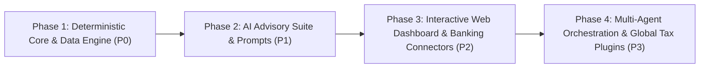

# Development Roadmap — OpenFamilyOffice

> **Strategic Phased Plan: From Deterministic Core to Multi-Agent Financial Intelligence.**

---

## Roadmap Overview

OpenFamilyOffice adheres to a disciplined engineering sequence:

$$\text{Data Schema First} \longrightarrow \text{Deterministic Engine} \longrightarrow \text{Advisory Prompts} \longrightarrow \text{UI Dashboard} \longrightarrow \text{Multi-Agent Automation}$$

We explicitly avoid starting with autonomous multi-agent frameworks (CrewAI, LangGraph, AutoGen) until the underlying data architecture and deterministic calculation math are verified and rock-solid.

---

## Phase 1: Deterministic Core & Data Engine (P0)

**Goal**: Establish a mathematically verifiable, local-first ledger with zero AI hallucinations.

- [x] Initial EGM architectural specification contracts (`PROJECT_CHARTER.md`, `FINANCIAL_DATA_ARCHITECTURE.md`, `AI_GOVERNANCE.md`).
- [x] Multi-entity reference CSV schemas (transactions, entities, categories, briefing template).
- [ ] Implement core Python data models (`dataclasses` / `Pydantic` / `SQLAlchemy`).
- [ ] Build the **Internal Transfer Neutralizer**: algorithm matching complementary debit/credit transactions within 48-hour windows to eliminate artificial revenue/expense duplication.
- [ ] Build the **Credit Card Settlement Reconciler**: ensuring card purchases are recorded on transaction dates without double-counting when invoice balances are settled.
- [ ] Implement deterministic financial metrics calculators:
  - Monthly essential living burn rate (Household).
  - Monthly operational fixed overhead (Business entities).
  - Exact liquid runway in months and days.
  - 13-week rolling cash flow forecast.
  - Brazilian MEI gross revenue ceiling tracker under Lei Complementar nº 238/2026 (R\$ 81.000, R\$ 110.000, R\$ 140.000).
- [ ] Unit test suite verifying double-entry mathematical invariants with 100% test pass rate.

---

## Phase 2: AI Advisory Suite & Weekly Briefings (P1)

**Goal**: Connect the deterministic calculation engine to the 7+1 Agent Advisory Council.

- [x] Author standardized system prompts with structured JSON output requirements:
  - `01_family_cfo.md`
  - `02_financial_controller_ledger.md`
  - `03_liquidity_risk.md`
  - `04_growth_pricing.md`
  - `05_tax_compliance_mei.md`
  - `06_stewardship_succession.md`
  - `07_adversarial_auditor_goldfish.md`
- [ ] Build CLI command `open-family-office briefing` to:
  1. Ingest monthly CSV/OFX records;
  2. Run the deterministic engine;
  3. Feed the validated JSON payload to the Family CFO prompt;
  4. Automatically run the Red Team (Goldfish) audit pass;
  5. Render the final 1-page Markdown Weekly Executive Briefing.
- [ ] Add dual-LLM backend support:
  - **Local Privacy Mode**: Ollama / NexusLocal (qwen2.5, llama3.3) for zero cloud transmission of sensitive financial data.
  - **Cloud Mode**: Claude 3.5 Sonnet, GPT-4o, or Gemini 1.5/2.0 with automated PII sanitization.

---

## Phase 3: Interactive Web Dashboard & Ingestion Pipelines (P2)

**Goal**: Provide a clean, accessible interface for family principals (Osmar & Vera) and streamline statement importing.

- [ ] Lightweight web UI (FastAPI backend + clean modern web interface).
- [ ] OFX and PDF bank statement parser for Brazilian institutions (Nubank, Inter, Itaú, Bradesco, Caixa, Banco do Brasil) and international formats (OFX/QFX/CSV).
- [ ] Visual Interactive Dashboard:
  - Tri-Perspective toggle (Cash Flow / Managerial Accrual / Family Net Worth).
  - 13-Week Cash Runway interactive chart.
  - Entity switcher (Consolidated Household vs Fix Serviços vs Facilita Vistorias).
  - MEI Revenue Ceiling progress gauge.
- [ ] In-browser Spousal Approval Workflow:
  - Review flagged transactions.
  - Approve proposed categories.
  - Joint spousal confirmation checkbox for capital expenditures over configured threshold.

---

## Phase 4: Multi-Agent Orchestration & Global Tax Plugins (P3)

**Goal**: Extend the platform for automated scheduled monitoring and global open-source adoption.

- [ ] Autonomous weekly cron runner (generating and delivering briefings via Telegram bot or secure local web notification).
- [ ] Read-only Open Finance / Banking API connectors (Pluggy, Belvo, Plaid) using read-only tokens.
- [ ] Modular International Tax Plugins:
  - `plugins/tax/brazil`: MEI, Simples Nacional (Annex III & IV), Lucro Presumido, Carnê-Leão.
  - `plugins/tax/usa`: Single-Member LLC, Schedule C, 1099-NEC, Quarterly Estimated Taxes.
  - `plugins/tax/spain`: Autónomo, IRPF trimestral, IVA Modelo 303.
  - `plugins/tax/uk`: Sole Trader, Self Assessment, VAT threshold.
- [ ] Capital Allocation AI module: portfolio rebalancing, inflation adjustments (IPCA / CPI), macro risk hedging.

