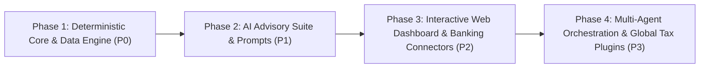

# Development Roadmap — OpenFamilyOffice

> **Strategic Phased Plan: From Deterministic Core to Multi-Agent Financial Intelligence.**

---

## Roadmap Overview

OpenFamilyOffice adheres to a disciplined engineering sequence:

$$\text{Data Schema First} \longrightarrow \text{Deterministic Engine} \longrightarrow \text{Advisory Prompts} \longrightarrow \text{UI Dashboard} \longrightarrow \text{Multi-Agent Automation}$$

We explicitly avoid starting with autonomous multi-agent frameworks (CrewAI, LangGraph, AutoGen) until the underlying data architecture and deterministic calculation math are verified and rock-solid.

---

## Phase 1: Deterministic Core & Data Engine (P0)

**Goal**: Establish a mathematically verifiable, local-first ledger with zero AI hallucinations.

- [x] Initial EGM architectural specification contracts (`PROJECT_CHARTER.md`, `FINANCIAL_DATA_ARCHITECTURE.md`, `AI_GOVERNANCE.md`).
- [x] Multi-entity reference CSV schemas (transactions, entities, categories, briefing template).
- [x] Implement core Python data models (`dataclasses` / `Pydantic` / `SQLAlchemy`).
- [x] Build the **Internal Transfer Neutralizer**: algorithm matching complementary debit/credit transactions within 48-hour windows to eliminate artificial revenue/expense duplication.
- [x] Build the **Credit Card Settlement Reconciler**: ensuring card purchases are recorded on transaction dates without double-counting when invoice balances are settled.
- [x] Implement deterministic financial metrics calculators:
  - Monthly essential living burn rate (Household).
  - Monthly operational fixed overhead (Business entities).
  - Exact liquid runway in months and days.
  - 13-week rolling cash flow forecast.
  - Brazilian MEI gross revenue ceiling tracker under Lei Complementar nº 238/2026 (R\$ 81.000, R\$ 110.000, R\$ 140.000).
- [x] Unit test suite verifying double-entry mathematical invariants with 100% test pass rate.

---

## Phase 2: AI Advisory Suite & Weekly Briefings (P1)

**Goal**: Connect the deterministic calculation engine to the 7+1 Agent Advisory Council.

- [x] Author standardized system prompts with structured JSON output requirements:
  - `01_family_cfo.md`
  - `02_financial_controller_ledger.md`
  - `03_liquidity_risk.md`
  - `04_growth_pricing.md`
  - `05_tax_compliance_mei.md`
  - `06_stewardship_succession.md`
  - `07_adversarial_auditor.md`
  - `08_receipt_ocr_parser.md` (Photo & NFC-e Vision Parser)
- [x] Author Receipt Photo & NFC-e OCR Ingestion Specification ([`docs/RECEIPT_OCR_INGESTION_SPEC.md`](docs/RECEIPT_OCR_INGESTION_SPEC.md)).
- [x] Build the **Receipt Ingestion Engine** (`src/controller/receipt_processor.py`):
  - Deterministic SEFAZ QR-Code / NFC-e decoder (100% exact itemized data for Brazilian retail).
  - Multimodal Vision AI parser fallback for non-QR receipts (via local `qwen2-vl` or cloud APIs).
- [x] Implement **Receipt-to-Bank Matching**: automatically attaching itemized receipts to card transactions to eliminate duplicate expense entries (`src/controller/receipt_matcher.py`).
- [x] Multi-Provider Free-Tier LLM Rate Limiter & Fallback Router ([`docs/LLM_RATE_LIMIT_AND_FALLBACK_SPEC.md`](docs/LLM_RATE_LIMIT_AND_FALLBACK_SPEC.md), `src/llm/`):
  - Sliding-window tracking for RPM, TPM, and RPD.
  - Proactive switching at 80% capacity to avoid 429 errors.
  - Cascade: Google Gemini Free -> Groq Free -> OpenRouter Free -> NVIDIA NIM API.
  - Zero-latency switching for interactive user calls; smooth non-blocking delay queue for background batch tasks.
- [x] Universal Custom Provider Registry & Multi-Protocol Client ([`docs/CUSTOM_PROVIDERS_AND_COMPATIBILITY_SPEC.md`](docs/CUSTOM_PROVIDERS_AND_COMPATIBILITY_SPEC.md), `src/llm/`):
  - Full support for **Anthropic-Compatible** (`/v1/messages`) and **OpenAI-Compatible** (`/v1/chat/completions`) endpoints.
  - Dynamic registration of any current or future provider by setting `base_url`, `api_key`, `protocol`, and `model`.
  - Automated importer for `.env` files (`python -m src.cli config import`).
  - Interactive CLI management: `config list`, `config add`, `config remove`, `config import`.
- [x] Daily Real-Time Macroeconomic Grounding & News Ingestion ([`docs/MACRO_NEWS_AND_MARKET_INTELLIGENCE_SPEC.md`](docs/MACRO_NEWS_AND_MARKET_INTELLIGENCE_SPEC.md), `src/intelligence/`):
  - Banco Central do Brasil (BCB/SGS) public API client for Selic Meta, Dólar PTAX, and IPCA 12M with zero API keys.
  - Financial RSS news ingestion and keyword filtering (Dólar, Selic, IPCA, Ibovespa, MEI).
  - Daily local snapshot caching (`data/macro_cache/`).
- [x] Curated Free Public APIs Integrations Suite ([`docs/PUBLIC_APIS_INTEGRATION_SPEC.md`](docs/PUBLIC_APIS_INTEGRATION_SPEC.md), `src/integrations/`):
  - FX rates & conversion via AwesomeAPI & Frankfurter API (`python -m src.cli market`).
  - Cryptocurrency pricing via Coinbase Public Spot & AwesomeAPI Crypto.
  - Corporate CNPJ client/vendor legal validation via BrasilAPI (`python -m src.cli cnpj <cnpj>`).
  - Banking calendar & settlement day rollover via BrasilAPI Feriados and Nager.Date (`python -m src.cli holidays`).
- [x] Build CLI command `open-family-office briefing` (`src/engine/briefing_runner.py`):
  1. Ingest monthly CSV/OFX records;
  2. Run the deterministic engine;
  3. Feed the validated JSON payload to the Family CFO prompt;
  4. Automatically run the Risk & Adversarial Audit (Red Team) pass;
  5. Render the final 1-page Markdown Weekly Executive Briefing (`reports/briefing_YYYY-MM-DD.md`).
- [x] Multi-provider LLM backend support:
  - **High-Performance Inference & Proactive Failover**: Google Gemini, Groq, NVIDIA NIM, OpenRouter, DeepSeek, Mistral, Anthropic Claude.
  - **Local PII Guard**: Strict Modulo-11 / SHA-256 masking before any provider call.

---

## Phase 3: Interactive Web Dashboard & Ingestion Pipelines (P2)

**Goal**: Provide a clean, accessible interface for family principals (Osmar & Vera) and streamline statement importing.

- [ ] Lightweight web UI (FastAPI backend + clean modern web interface).
- [ ] Mobile Photo Receipt Capture: Telegram / WhatsApp Bot integration and PWA mobile camera upload for instant on-the-go receipt submission.
- [ ] OFX and PDF bank statement parser for Brazilian institutions (Nubank, Inter, Itaú, Bradesco, Caixa, Banco do Brasil) and international formats (OFX/QFX/CSV).
- [ ] Visual Interactive Dashboard:
  - Tri-Perspective toggle (Cash Flow / Managerial Accrual / Family Net Worth).
  - 13-Week Cash Runway interactive chart.
  - Entity switcher (Consolidated Household vs Fix Serviços vs Facilita Vistorias).
  - MEI Revenue Ceiling progress gauge.
- [ ] In-browser Spousal Approval Workflow:
  - Review flagged transactions.
  - Approve proposed categories.
  - Joint spousal confirmation checkbox for capital expenditures over configured threshold.

---

## Phase 4: Multi-Agent Orchestration & Global Tax Plugins (P3)

**Goal**: Extend the platform for automated scheduled monitoring and global open-source adoption.

- [ ] Autonomous weekly cron runner (generating and delivering briefings via Telegram bot or secure local web notification).
- [ ] Read-only Open Finance / Banking API connectors (Pluggy, Belvo, Plaid) using read-only tokens.
- [ ] Modular International Tax Plugins:
  - `plugins/tax/brazil`: MEI, Simples Nacional (Annex III & IV), Lucro Presumido, Carnê-Leão.
  - `plugins/tax/usa`: Single-Member LLC, Schedule C, 1099-NEC, Quarterly Estimated Taxes.
  - `plugins/tax/spain`: Autónomo, IRPF trimestral, IVA Modelo 303.
  - `plugins/tax/uk`: Sole Trader, Self Assessment, VAT threshold.
- [ ] Capital Allocation AI module: portfolio rebalancing, inflation adjustments (IPCA / CPI), macro risk hedging.

