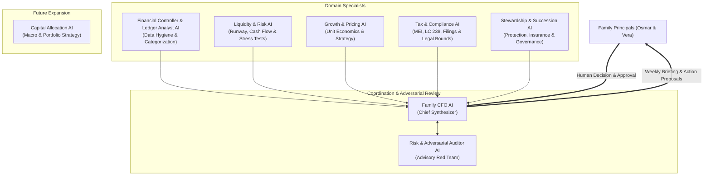

# AI Governance & Agent Architecture — OpenFamilyOffice

> **Operational Contract: The 7+1 Agent Advisory Council, Deterministic Boundaries, Human Sovereignty, and Privacy Compliance.**

---

## 1. The Core Rule: Code Calculates, AI Interprets

The foundational law of OpenFamilyOffice is:

$$\text{Financial Truth} = \text{Deterministic Code} + \text{Audited Records}$$

No Artificial Intelligence agent is permitted to perform mental arithmetic to determine:
* Cash runway or burn rates.
* Gross or net profit margins.
* Tax obligations, DAS values, or tax bracket changes.
* 13-week cash flow projections.
* Net worth totals or asset valuations.

**Division of Responsibility:**
1. **The Deterministic Financial Engine (Python/SQL)** computes exact figures, validates double-entry reconciliations, flags transfers, and outputs a structured JSON summary.
2. **The AI Advisory Council** ingests this structured summary to analyze context, identify qualitative patterns, generate strategic trade-offs, draft communications, and construct a concise 1-page weekly briefing.

If an AI agent requires an uncalculated metric, it is strictly forbidden from guessing. It must output: `[CALCULATION_REQUIRED: <metric_name>]`.

---

## 2. The AI Advisory Council (The 7+1 Agent Roster)

OpenFamilyOffice structures advisory agents into a specialized council:



---

### Agent Specifications

#### 1. Family CFO AI (Chief Advisory Coordinator)
* **Role**: Primary interface to the family principals. Synthesizes inputs from all specialist agents into a clean, 1-page Weekly Briefing.
* **Core Responsibilities**:
  * Prioritizes decisions by urgency and financial impact.
  * Formulates the "Top 3 Actions of the Week."
  * Ensures household goals and corporate goals remain aligned.
  * Enforces the agenda for the 30-minute weekly family finance meeting.
* **Anchor Question**: *"What are the critical decisions we must make this week to protect cash, optimize profitability, and grow family net worth?"*

#### 2. Financial Controller & Ledger Analyst AI
* **Role**: Guardian of data quality, transaction hygiene, and categorization.
* **Core Responsibilities**:
  * Identifies unclassified transactions, orphaned entries, and categorization anomalies.
  * Detects duplicate subscriptions, price increases from vendors, and recurring leaks.
  * Validates that internal transfers between accounts are properly paired.
  * Checks for commingling between Personal (PF) and Business (PJ) accounts.
* **Anchor Question**: *"Where are the inconsistencies, leaks, and misclassified transactions across all entities?"*

#### 3. Liquidity & Risk AI
* **Role**: Protector of cash runway and crisis preparedness.
* **Core Responsibilities**:
  * Analyzes the 13-week rolling cash forecast computed by the engine.
  * Monitors emergency reserves (household) and operating reserves (Fix & Facilita).
  * Simulates adverse stress scenarios (e.g., losing a major client, 60-day receivables delay, macro market correction).
  * Enforces crisis playbook triggers.
* **Anchor Question**: *"If all revenue stopped tomorrow, how many months does each entity survive, and what pre-emptive actions must be taken today?"*

#### 4. Growth & Pricing AI
* **Role**: Commercial strategist for operating businesses (Fix Serviços & Facilita Vistorias).
* **Core Responsibilities**:
  * Analyzes unit economics, contribution margins per service, and hourly revenue realization.
  * Identifies high-friction/low-margin clients consuming excessive capacity.
  * Designs pricing adjustments, contract deposits, late payment penalties, and billing schedules.
  * For early-stage validation ventures (e.g., Facilita Vistorias), tracks CAC, payback periods, and enforces strict testing spend caps.
* **Anchor Question**: *"Which services, prices, or clients should we renegotiate or eliminate to increase profit margins without increasing working hours?"*

#### 5. Tax & Compliance AI
* **Role**: Fiscal calendar navigator and jurisdictional compliance watchdog.
* **Core Responsibilities**:
  * Tracks Brazilian MEI revenue caps under **Lei Complementar nº 238/2026** (R\$ 81.000 in 2026; R\$ 110.000 in 2027; R\$ 140.000 in 2028).
  * Monitors the monthly DAS payment calendar and annual DASN declarations.
  * Flags legal restrictions (e.g., alerting if an individual MEI holder is designated as an administrator or partner in another company).
  * Prepares structured checklists and questions for the external accountant when nearing Simples Nacional transition.
* **Anchor Question**: *"What upcoming legal deadlines, revenue ceilings, or tax changes could expose our businesses to penalties or mandatory regime changes?"*

#### 6. Stewardship & Succession AI
* **Role**: Long-term asset protector, legal structure advisor, and estate steward.
* **Core Responsibilities**:
  * Audits asset shielding and personal liability firewalls between PF and PJ operations.
  * Reviews family insurance coverage (life, disability, professional indemnity, business liability).
  * Maintains an emergency document registry (wills, powers of attorney, digital asset keys, corporate bylaws).
  * Prepares questions for legal counsel on future holding structures or succession plans.
* **Anchor Question**: *"What legal, fiscal, or personal vulnerability could threaten our family's security if an unexpected crisis occurs tomorrow?"*

#### 7. Risk & Adversarial Auditor AI (Advisory Council Red Team)
* **Role**: Financial devil's advocate that ruthlessly stress-tests every recommendation made by the Family CFO AI.
* **Core Responsibilities**:
  * Evaluates downside shocks without emotional attachment or confirmation bias.
  * Actively attacks assumptions: *"What if the client does not accept the price increase?", "What if inflation accelerates?", "Is this calculation based on unverified numbers?"*
  * Protects against confirmation bias, premature capital deployment, and over-optimism.
* **Anchor Question**: *"Why is the Family CFO's proposed plan fragile, flawed, or overly optimistic?"*

#### 8. [Future Module] Capital Allocation AI
* **Role**: Long-term portfolio and wealth preservation strategist.
* **Activation Gate**: Activated only after the family maintains 6+ months of verified emergency reserves, zero high-interest debt, and steady predictable free cash flow.
* **Core Responsibilities**: Asset allocation, inflation hedging (IPCA+ / TIPS), macro rebalancing, and global diversification.

---

## 3. Human Sovereignty & The Tiered Approval Matrix

OpenFamilyOffice strictly adheres to the principle that **the machine proposes, the human disposes**.

| Governance Tier | Permitted AI Action | Required Human Action | Examples |
|---|---|---|---|
| **Tier 0: Autonomous Engine** | Deterministic calculations, statement parsing, file schema validation. | None (System runs automatically). | Importing an OFX file, pairing identical debit/credit transfers. |
| **Tier 1: AI Advisory Proposal** | Flagging anomalies, proposing transaction categories, drafting weekly briefs. | Optional review by user. | AI suggests categorizing a purchase as "Office Supplies". |
| **Tier 2: Controlled Operational Action** | Generating invoice PDFs, drafting collection emails, adjusting validation budgets. | **Explicit Human Approval Required**. | Sending a late payment reminder to a client, approving a R\$ 500 ad test for Facilita Vistorias. |
| **Tier 3: Capital Movement & Legal Action** | **STRICTLY FORBIDDEN**. AI cannot execute transfers, trade assets, or sign contracts. | **Solely Human Execution**. | Transferring funds between banks, paying the DAS slip, signing corporate bylaws. |

### Spousal Governance & Dual-Key Approval Rules
For co-managed family finances (e.g., Osmar & Vera):
1. **Discretionary Limit**: Each principal has an agreed monthly discretionary allowance (no joint approval required).
2. **Joint Approval Gate**: Any capital expenditure, business investment, or contract exceeding an agreed threshold (e.g., R\$ 1.000) requires formal confirmation by both principals.
3. **Weekly 30-Minute Ritual**: The system schedules a weekly meeting:
   * 10 minutes: Reviewing the numbers and cash runway.
   * 10 minutes: Reviewing open risks and Red Team critiques.
   * 10 minutes: Voting on proposed decisions.

---

## 4. Privacy, LGPD & GDPR Data Protection

Financial data requires maximum security and compliance with the Brazilian General Data Protection Law (LGPD) and international GDPR standards.

```
┌────────────────────────────────────────────────────────────────────────┐
│                      DATA CLASSIFICATION TIERS                         │
├───────────────┬─────────────────────────────────┬──────────────────────┤
│ Tier Level    │ Data Elements                   │ Processing Boundary  │
├───────────────┼─────────────────────────────────┼──────────────────────┤
│ TIER 1:       │ Aggregated monthly totals,      │ Can be processed by  │
│ Internal      │ category percentages, runway    │ commercial Cloud     │
│ Aggregates    │ months (without names or PII).  │ LLMs (Claude, GPT,   │
│               │                                 │ Gemini).             │
├───────────────┼─────────────────────────────────┼──────────────────────┤
│ TIER 2:       │ Sanitized transaction lists,    │ Cloud LLM permitted  │
│ Pseudonymized │ counterparty codes (e.g.        │ ONLY with Zero Data  │
│ Transactions  │ "Client_A", "Supplier_04").     │ Retention agreement. │
├───────────────┼─────────────────────────────────┼──────────────────────┤
│ TIER 3:       │ Full tax IDs (CPF/CNPJ), bank   │ NEVER sent to cloud  │
│ Highly        │ account numbers, passwords,     │ APIs. Processed      │
│ Confidential  │ client addresses, raw bank OFX. │ LOCALLY via Ollama   │
│               │                                 │ or NexusLocal only.  │
└───────────────┴─────────────────────────────────┴──────────────────────┘
```

### Local Processing Capabilities
OpenFamilyOffice is architected to allow complete offline operation:
* Local database (PostgreSQL / SQLite).
* Local deterministic calculation engine (Python).
* Local LLM routing (via Ollama or local endpoint) for sensitive categorization and parsing.

