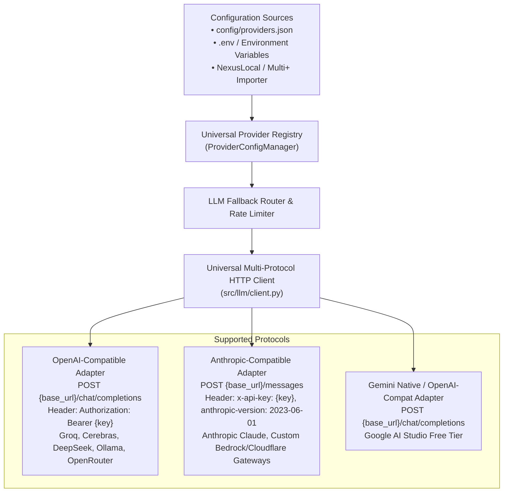

# Custom LLM Providers & Multi-Protocol Compatibility Specification

> **Technical Specification: Universal Provider Registry, Anthropic & OpenAI Protocol Compatibility, Dynamic Base URL Configuration, and NexusLocal / .env Importer.**

---

## 1. Problem Statement & Motivation

AI infrastructure evolves at breakneck speed. New inference providers (such as Groq, Cerebras, SambaNova, DeepSeek, Together AI, Mistral, and local proxies) appear constantly with varying free tiers, aggressive rate limits, and custom endpoints. 

Hardcoding specific providers into a codebase creates rigidity and obsolescence:
1. When a new provider launches with a generous free tier or lower latency, developers shouldn't need to refactor the core system to support it.
2. Users who already have API keys configured in other tools (e.g., **NexusLocal / Multi+**) should not have to manually re-type dozens of keys.
3. Different providers communicate via two primary API protocols in the modern ecosystem:
   * **OpenAI-Compatible (`/v1/chat/completions`)**: Used by 90% of open-source and alternative model clouds (Groq, Cerebras, DeepSeek, OpenRouter, SambaNova, SiliconFlow, Ollama, vLLM).
   * **Anthropic-Compatible (`/v1/messages`)**: Used by Anthropic Claude and custom enterprise/proxy gateways supporting Anthropic headers (`x-api-key`, `anthropic-version`).

**OpenFamilyOffice** introduces a **Universal, Extensible Provider Registry** that allows users to register **any current or future LLM provider** simply by specifying its `protocol`, `base_url`, `api_key`, and `model`.

---

## 2. Architecture & Registry Model



---

## 3. Data Schema: `ProviderConfig`

Every registered provider in `config/providers.json` conforms to this schema:

```json
{
  "id": "deepseek-custom",
  "name": "DeepSeek V3 API",
  "protocol": "openai",
  "base_url": "https://api.deepseek.com/v1",
  "api_key": "${DEEPSEEK_API_KEY}",
  "model": "deepseek-chat",
  "priority": 2,
  "enabled": true,
  "limits": {
    "rpm_limit": 60,
    "tpm_limit": 100000,
    "rpd_limit": 5000,
    "proactive_threshold_pct": 0.80
  },
  "custom_headers": {}
}
```

### Supported Protocols:
1. **`openai`**:
   * Endpoint: `{base_url}/chat/completions`
   * Headers: `Authorization: Bearer <api_key>`, `Content-Type: application/json`
   * Request Body: `{"model": "...", "messages": [{"role": "system", "content": "..."}, {"role": "user", "content": "..."}], "temperature": 0.2}`
2. **`anthropic`**:
   * Endpoint: `{base_url}/messages`
   * Headers: `x-api-key: <api_key>`, `anthropic-version: 2023-06-01`, `Content-Type: application/json`
   * Request Body: `{"model": "...", "system": "...", "messages": [{"role": "user", "content": "..."}], "max_tokens": 4096}`
3. **`gemini`**:
   * Standard Google Gemini free endpoint or OpenAI-compatible endpoint.

---

## 4. NexusLocal / Multi+ Automated Importer

The system includes a dedicated migration utility ([`src/llm/importer.py`](../src/llm/importer.py)) capable of ingesting an existing `.env` file from **NexusLocal / Multi+** or other local setups:

### Recognized Key Mappings:
| Environment Variable | Auto-Configured Provider | Protocol | Default Free Model |
|---|---|---|---|
| `GEMINI_API_KEY` | Google Gemini Free | `gemini` / `openai` | `gemini-2.0-flash` |
| `GROQ_API_KEY` | Groq Ultra-Fast | `openai` | `llama-3.3-70b-versatile` |
| `OPENROUTER_API_KEY` | OpenRouter Community | `openai` | `meta-llama/llama-3.3-70b-instruct:free` |
| `CEREBRAS_API_KEY` | Cerebras Inference | `openai` | `llama3.3-70b` |
| `SAMBANOVA_API_KEY` | SambaNova Systems | `openai` | `Meta-Llama-3.3-70B-Instruct` |
| `DEEPSEEK_API_KEY` | DeepSeek AI | `openai` | `deepseek-chat` |
| `MISTRAL_API_KEY` | Mistral AI | `openai` | `mistral-small-latest` |
| `ANTHROPIC_API_KEY` | Anthropic Claude | `anthropic` | `claude-3-5-sonnet-20241022` |
| `OLLAMA_BASE_URL` | Local Ollama | `openai` | `qwen2.5:14b` |

---

## 5. CLI Management Interface

Users can manage providers without editing code:

```bash
# List all registered providers and their priority/status
python -m src.cli config list

# Auto-import keys from an existing NexusLocal .env
python -m src.cli config import --source "J:\Arquivos Osmar\Multi+\.env"

# Register any custom OpenAI-compatible provider
python -m src.cli config add \
  --id "cerebras" \
  --name "Cerebras Fast" \
  --protocol "openai" \
  --base-url "https://api.cerebras.ai/v1" \
  --api-key "csk-..." \
  --model "llama3.3-70b" \
  --rpm 30 --priority 2

# Register any custom Anthropic-compatible provider / proxy
python -m src.cli config add \
  --id "custom-claude-gateway" \
  --name "Corporate Claude Gateway" \
  --protocol "anthropic" \
  --base-url "https://gateway.ai.cloudflare.com/v1/.../anthropic/v1" \
  --api-key "sk-ant-..." \
  --model "claude-3-5-sonnet-20241022" \
  --priority 1

# Test connectivity with a lightweight ping prompt
python -m src.cli config test --provider "cerebras"
```

---

## 6. Privacy & Security Invariant

* All sensitive API keys in `config/providers.json` and `.env` are strictly excluded from version control via `.gitignore`.
* A sanitized template is provided at `config/providers.example.json`.
* Keys can be declared directly or referenced as environment variable tokens (e.g. `"${GROQ_API_KEY}"`).
