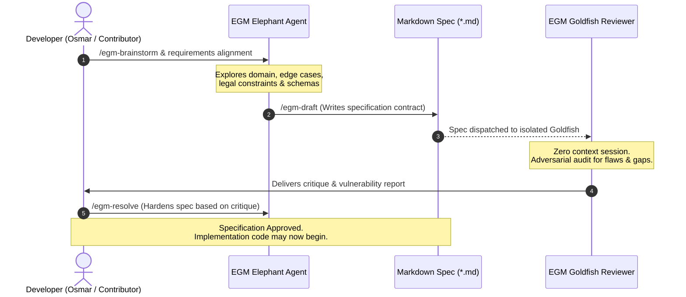

# Elephant-Goldfish Model (EGM) Development Specification

> **Operational Standard: Spec-Driven Development, Context Segregation, and Adversarial Design Review in OpenFamilyOffice.**

---

## 1. What is the Elephant-Goldfish Model (EGM)?

The **Elephant-Goldfish Model (EGM)** is an open-source framework and methodology introduced by Google (published on the *Google Open Source Blog*, October 2026). It was designed to solve the "slop crisis" and hallucinations that occur when AI assistants write code impulsively without rigorous design contracts.

EGM enforces a strict bifurcation of intelligence:

```
┌───────────────────────────────────────┬───────────────────────────────────────┐
│          THE ELEPHANT                 │          THE GOLDFISH                 │
│      (Deep Context & Memory)          │      (Zero Context & Scrutiny)        │
├───────────────────────────────────────┼───────────────────────────────────────┤
│ • Remembers project history & vision  │ • Dispatched in a fresh, isolated     │
│ • Holds long-horizon context & goals  │   session with ZERO chat history      │
│ • Interviews the human developer      │ • Analyzes ONLY the written spec      │
│ • NEVER writes implementation code    │   and code files on disk              │
│ • Compiles Markdown specifications    │ • Acts as a cold adversarial reviewer │
│ • Understands the "why"               │ • Exposes blind spots and edge cases  │
└───────────────────────────────────────┴───────────────────────────────────────┘
```

---

## 2. How OpenFamilyOffice Adopts EGM

OpenFamilyOffice uses EGM at two distinct levels:
1. **Software Engineering Process**: All new modules, calculation engines, and database migrations for OpenFamilyOffice must have an approved `.md` specification before code is committed.
2. **Internal Financial Advisory Council**: The system's agent architecture itself embodies EGM principles:
   * **The Family CFO AI** acts as the *Elephant*: holding family memory, long-term goals, and strategic context.
   * **The Adversarial Auditor AI** acts as the *Goldfish*: evaluating weekly financial recommendations without emotional attachment or confirmation bias.

---

## 3. The EGM Spec-Driven Workflow

Before implementing any feature or tax module, follow this three-stage cycle:



---

## 4. Architectural Contracts: Hay and Peanuts

EGM organizes project documentation into hierarchical contracts:

### 1. Root Blueprint (Hay)
* Located at the repository root (`README.md` and `docs/`).
* Provides the high-altitude architectural contract:
  * Invariants (rules that can never be broken).
  * Synchronous vs. asynchronous execution boundaries.
  * Security policies and data classifications.
  * Index of all child subsystems.

### 2. Package Contracts (Peanuts)
* Located in leaf directories (e.g., `src/controller/README.md`, `src/tax/README.md`).
* Specifies atomic operational contracts:
  * Inputs and output types.
  * Error modes and fallback mechanisms.
  * Mathematical invariants (e.g., "Sum of paired transfers must equal zero").
  * Verification test commands (e.g., `pytest tests/test_transfers.py`).

---

## 5. EGM Invariants in this Repository

Contributors and automated agents modifying OpenFamilyOffice must respect these non-negotiables:

1. **No Code Without Spec**: Any PR introducing a new calculation algorithm, database entity, or external integration must include an updated or new technical specification document.
2. **Grounding in Code**: No specification may reference fictional tables or speculative APIs. All symbols, tables, and routines cited must match the codebase.
3. **No Multiline Table Rows**: Markdown tables must keep every row on a single line for proper rendering across GitHub and documentation static-site generators.
4. **Clean Link Resolution**: Every relative link in Markdown files (`[Link](../docs/...)`) must resolve to a valid file on disk.

---

## 6. Running EGM Skills with Antigravity and Coding Agents

When working on this repository with Google Antigravity or compatible agent harnesses:

* **To brainstorm an architecture or feature**:
  ```text
  Run EGM Brainstorm: Analyze requirements for the Brazilian Simples Nacional tax transition engine.
  ```
* **To draft a formal specification**:
  ```text
  Run EGM Draft: Draft the technical specification for OFX parsing and transaction deduplication into docs/specs/ofx_ingestion.md.
  ```
* **To trigger an adversarial Goldfish review**:
  ```text
  Spawn an isolated Goldfish subagent to review docs/specs/ofx_ingestion.md against our Financial Data Architecture invariants.
  ```

