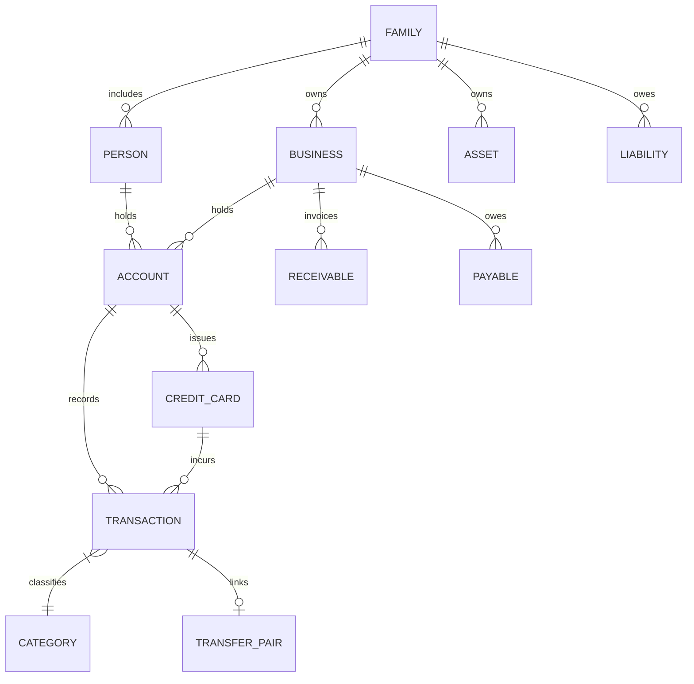

# Financial Data Architecture — OpenFamilyOffice

> **Technical Specification: Unified Data Model, Reconciliation Engine, and Multi-Perspective Accounting.**

---

## 1. System Data Architecture Overview

The core failure mode of financial software is "garbage in, garbage out." If raw transaction data is corrupted, duplicate, or misclassified, any AI analysis layered on top becomes dangerous hallucination. 

OpenFamilyOffice establishes a **Central Financial Data Layer** that acts as the single source of truth (SSOT). All ingestion pipelines (CSV, OFX, Open Finance) normalize into this layer, where a deterministic **Financial Controller Engine** enforces integrity rules before any data is surfaced to users or AI agents.

```mermaid
flowchart TD
    subgraph Ingestion["1. Ingestion Sources"]
        A1["Bank Statements (OFX/CSV)"]
        A2["Credit Card Invoices"]
        A3["Invoices & Contracts (Receivables)"]
        A4["Manual / Spreadsheet Entries"]
        A5["Receipt & NFC-e Photos (OCR / QR-Code)"]
    end

    subgraph DataLayer["2. Central Financial Data Layer (SSOT)"]
        B1["Entity Registry (PF / PJ1 / PJ2)"]
        B2["Account & Card Master"]
        B3["Normalized Transactions Table"]
        B4["Reconciled Transfer Pairs"]
        B5["Asset & Liability Register"]
    end

    subgraph Controller["3. Deterministic Controller & Calculation Engine (Python/SQL)"]
        C1["Internal Transfer Neutralizer"]
        C2["Credit Card Double-Count Eliminator"]
        C3["Tri-Perspective Engine (Cash vs Accrual vs Wealth)"]
        C4["13-Week Cash Flow & Runway Calculator"]
        C5["Tax & Legal Limit Monitor (MEI / LC 238)"]
    end

    subgraph Intelligence["4. AI Advisory Team (Read-Only Verified Data)"]
        D1["Family CFO AI"]
        D2["Ledger Analyst AI"]
        D3["Liquidity & Risk AI"]
        D4["Growth & Pricing AI"]
        D5["Tax & Compliance AI"]
        D6["Stewardship & Succession AI"]
        D7["Adversarial Auditor AI (Goldfish)"]
    end

    subgraph Output["5. User Governance & UI"]
        E1["Weekly Executive Briefing (1-Page)"]
        E2["Financial Health Dashboard"]
        E3["Human Decision & Action Approvals"]
    end

    Ingestion --> DataLayer
    DataLayer --> Controller
    Controller --> Intelligence
    Intelligence --> Output
```

---

## 2. Core Relational Entity Model

The relational model enforces multi-entity separation and auditable tracking.

### Entity Relationship Diagram (ERD)

### Table Specifications

#### 2.1. `entities` (Persons and Businesses)
Stores the legal participants of the family office.
* `id` (UUID, Primary Key)
* `type` (`PERSONAL_INDIVIDUAL`, `BUSINESS_MEI`, `BUSINESS_SIMPLES`, `BUSINESS_LLC`, `BUSINESS_CORP`)
* `legal_name` (Text, e.g., "Fix Serviços Elétricos", "Facilita Vistorias Imobiliárias", "Osmar Henzen")
* `trade_name` (Text)
* `tax_id` (Text, encrypted/masked, e.g., CPF or CNPJ)
* `jurisdiction` (Text, ISO 3166-1 alpha-2, default: `BR`)
* `ownership_structure` (JSONB, e.g., `{"Osmar": 1.0}` or `{"Osmar": 0.5, "Partner": 0.5}`)
* `active` (Boolean, default: `true`)

> [!IMPORTANT]
> **MEI Legal Restriction Constraint**: Under Brazilian Federal Law (Lei Complementar nº 123/2006), an individual who holds a MEI registration CANNOT be a partner, administrator, or titular in another corporate entity. The system checks `entities` to alert users of compliance risks if a MEI owner is registered as a partner in another business.

#### 2.2. `accounts`
Bank accounts, wallets, and cash reserves.
* `id` (UUID, Primary Key)
* `entity_id` (UUID, Foreign Key -> `entities.id`)
* `institution_name` (Text, e.g., "Nubank", "Inter", "Itaú", "Chase")
* `account_type` (`CHECKING`, `SAVINGS`, `INVESTMENT`, `CASH_WALLET`)
* `currency` (Text, ISO 4217, default: `BRL`)
* `initial_balance` (Numeric 18,2)
* `current_balance` (Numeric 18,2)
* `last_reconciled_at` (Timestamp)

#### 2.3. `credit_cards`
Credit lines with statement billing cycles.
* `id` (UUID, Primary Key)
* `entity_id` (UUID, Foreign Key -> `entities.id`)
* `account_id` (UUID, Foreign Key -> `accounts.id`, auto-pay account)
* `card_name` (Text, e.g., "Nubank Mastercard Black PJ")
* `closing_day` (Integer, 1-31)
* `due_day` (Integer, 1-31)
* `credit_limit` (Numeric 18,2)

#### 2.4. `transactions`
Atomic record of money movement.
* `id` (UUID, Primary Key)
* `entity_id` (UUID, Foreign Key -> `entities.id`)
* `account_id` (UUID, Foreign Key -> `accounts.id`, nullable if card transaction)
* `credit_card_id` (UUID, Foreign Key -> `credit_cards.id`, nullable)
* `date` (Date, ISO 8601 `YYYY-MM-DD`)
* `amount` (Numeric 18,2, positive for inflows, negative for outflows)
* `currency` (Text, ISO 4217, default: `BRL`)
* `raw_description` (Text, original string from bank statement)
* `clean_description` (Text, sanitized merchant/client name)
* `category_id` (UUID, Foreign Key -> `categories.id`)
* `counterparty_name` (Text)
* `counterparty_tax_id` (Text, nullable)
* `is_transfer` (Boolean, default: `false`)
* `transfer_pair_id` (UUID, Foreign Key -> `transfer_pairs.id`, nullable)
* `reconciliation_status` (`CONFIRMED`, `ESTIMATED`, `PENDING_REVIEW`)
* `source_file_id` (UUID, audit tracking)
* `notes` (Text)

#### 2.5. `transfer_pairs`
Ensures internal money transfers do not distort financial statements.
* `id` (UUID, Primary Key)
* `source_transaction_id` (UUID, Foreign Key -> `transactions.id`)
* `destination_transaction_id` (UUID, Foreign Key -> `transactions.id`)
* `transfer_type` (`INTERNAL_SAME_ENTITY`, `CAPITAL_CONTRIBUTION`, `DIVIDEND_DISTRIBUTION`, `PRO_LABORE_PAYMENT`, `INTERCOMPANY_LOAN`)
* `reconciled` (Boolean)

#### 2.6. `categories`
Hierarchical chart of accounts supporting both household and commercial structures.
* `id` (UUID, Primary Key)
* `parent_id` (UUID, nullable)
* `name` (Text)
* `scope` (`PERSONAL`, `BUSINESS`, `TAX`, `INVESTMENT`, `TRANSFER`)
* `code` (Text, e.g., `1.1.01` for Assets, `4.1.02` for Operating Expenses)
* `is_essential` (Boolean, used for emergency reserve runway calculation)

#### 2.7. `receivables` & `payables`
Accrual tracking for future obligations.
* `id` (UUID, Primary Key)
* `entity_id` (UUID, Foreign Key -> `entities.id`)
* `counterparty_name` (Text, customer or vendor)
* `issue_date` (Date)
* `due_date` (Date)
* `original_amount` (Numeric 18,2)
* `remaining_amount` (Numeric 18,2)
* `status` (`OPEN`, `PAID`, `OVERDUE`, `CANCELLED`)
* `penalty_rate` (Numeric 5,4)
* `daily_interest_rate` (Numeric 5,4)

#### 2.8. `assets` & `liabilities`
Long-term wealth tracking.
* `id` (UUID, Primary Key)
* `entity_id` (UUID, Foreign Key -> `entities.id`)
* `type` (`REAL_ESTATE`, `VEHICLE`, `EQUITY`, `FIXED_INCOME`, `MORTGAGE`, `DEBT`)
* `valuation_amount` (Numeric 18,2)
* `valuation_date` (Date)
* `liquidity_days` (Integer, days required to liquidate, 0 = immediate)

---

## 3. The Tri-Perspective Accounting Model

OpenFamilyOffice simultaneously calculates three distinct views of economic activity:

| Perspective | Question Answered | Accounting Basis | Primary Artifacts |
|---|---|---|---|
| **1. Cash Flow (Financeiro)** | *How much actual cash do we have right now and will we survive the next 13 weeks?* | Cash Basis (Receipts and Disbursements) | Statement of Cash Flows (DFC), 13-Week Cash Forecast, Days of Liquidity. |
| **2. Managerial (Competência)** | *Are Fix Serviços and Facilita Vistorias actually profitable this month?* | Accrual Basis (Invoiced Services & Incurred Costs) | Managerial P&L (DRE), Contribution Margin by Client, Unit Economics. |
| **3. Balance Sheet (Patrimonial)** | *Is the family building real wealth or just running on a treadmill?* | Net Worth (Assets minus Liabilities adjusted for inflation) | Family Balance Sheet, Net Worth Evolution, Debt-to-Asset Ratio. |

### Practical Example of Separation:
Suppose *Fix Serviços* completes an electrical inspection contract for **R\$ 3.000** on **November 10**:
* Customer pays via invoice due on **December 10**.
* **In November**:
  * Accrual (Managerial): Revenue recognizes **+R\$ 3.000** in November.
  * Balance Sheet: Accounts Receivable increases by **+R\$ 3.000**.
  * Cash Flow (Financeiro): **R\$ 0,00** cash inflow.
* **In December** (When payment settles):
  * Cash Flow (Financeiro): **+R\$ 3.000** actual cash deposit recorded in checking.
  * Balance Sheet: Accounts Receivable decrements by **-R\$ 3.000**; Cash increases by **+R\$ 3.000**.
  * Accrual: **R\$ 0,00** new revenue (already earned in November).

Without this tri-perspective engine, the user would either feel falsely rich in November (claiming profit without cash to pay bills) or falsely poor in December (confusing old collections with new sales).

---

## 4. Deterministic Controller & Reconciliation Rules

The Financial Controller code enforces four deterministic invariants:

### Rule 1: Internal Transfer Neutralization
When money moves between two accounts owned by the system (e.g., Transfer of R\$ 2.000 from Fix Nubank PJ to Osmar Nubank PF as Pro-labore):
1. The debit on Account A (`-R$ 2.000`) and the credit on Account B (`+R$ 2.000`) within a 48-hour matching window are paired into a `transfer_pair`.
2. The controller marks both transactions with `is_transfer = true`.
3. In consolidated family cash flow, net cash impact is **R\$ 0,00**.
4. In managerial reporting, it is recognized as `PRO_LABORE_WITHDRAWAL` (Corporate expense for Fix, Personal income for Osmar), completely eliminating artificial revenue/expense duplication.

### Rule 2: Credit Card Invoicing Double-Count Prevention
1. Individual credit card transactions are recorded as expenses at the time of purchase (Accrual basis).
2. When the monthly credit card invoice payment is executed from the checking account (e.g., `-R$ 1.850`), the controller marks this payment as a **Liability Settlement / Transfer**, NOT a new expense.
3. This ensures expenses are counted exactly once.

### Rule 3: Confidence & Traceability Rating
Every number supplied to an AI agent or dashboard carries a deterministic confidence tag:
* `CONFIRMED`: Backed by reconciled bank statements, signed contracts, or official tax receipts.
* `ESTIMATED`: Derived via deterministic calculation using documented parameters (e.g., 13-week forecast assuming 90% collection rate).
* `PENDING`: Unclassified transactions, unverified invoices, or unconfirmed statements.

### Rule 4: MEI Fiscal Limits & Ceiling Monitoring (Brazil)
Under **Lei Complementar nº 238, de 21 de outubro de 2026**, the annual gross revenue ceilings for Microempreendedor Individual (MEI) are:
* **2026**: R\$ 81.000,00
* **2027**: R\$ 110.000,00 (with allowance for up to 2 employees)
* **2028**: R\$ 140.000,00

The controller maintains a running Year-to-Date (YTD) revenue tally for each MEI entity. If YTD revenue reaches:
* **80% of annual limit**: Issues a Caution notice to prepare for Simples Nacional transition.
* **100% of annual limit**: Issues a High-Severity alert regarding mandatory regime change and tax recalibration.

### Rule 5: Receipt Photo Anti-Duplication & Bank Matching
When a receipt photo (e.g., supermarket receipt, electrical supplier invoice) is ingested:
1. The deterministic QR-Code decoder or Vision AI extracts Date, Merchant, Total Amount, and Payment Method.
2. The controller checks whether a card or bank transaction with the matching amount exists within a $\pm 48\text{ hour}$ window.
3. If matched, the receipt line items are attached to the existing card transaction without creating a duplicate expense.
4. If payment was cash, a single confirmed cash expense is registered.
5. See full specification in [`docs/RECEIPT_OCR_INGESTION_SPEC.md`](./RECEIPT_OCR_INGESTION_SPEC.md).

---

## 5. Standard Data Interchange Formats

OpenFamilyOffice accepts data via standard CSV schemas detailed in `/templates`:
1. `transactions_template.csv`: Standard ledger import format.
2. `entities_template.csv`: Legal entity registry format.
3. `categories_template.csv`: Chart of accounts and categorization hierarchy.

