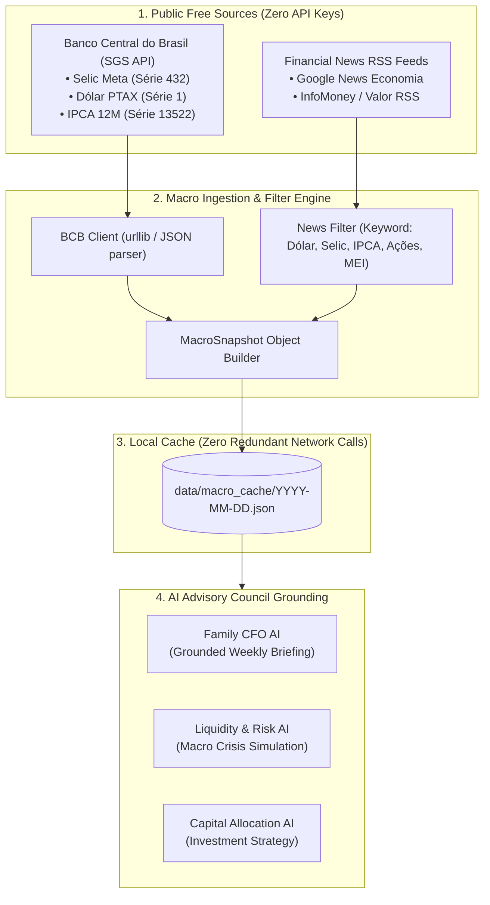

# Macro News & Market Economic Intelligence Ingestion Specification

> **Technical Specification: Real-Time Economic Grounding, Public Financial APIs (BCB/SGS), RSS Economic News Ingestion, and Caching.**

---

## 1. Problem Statement & Motivation

Financial planning cannot operate in an economic vacuum. Decisions regarding:
* Buying foreign currency (Dólar / USD);
* Allocating savings between floating rate (CDI/Selic) and inflation-protected bonds (IPCA+);
* Evaluating stock market entries or tech bubble corrections;
* Commercial pricing for Fix Serviços and Facilita Vistorias;

depend directly on current macroeconomic reality. If an AI agent relies solely on its pre-trained knowledge base, its advice will cite outdated interest rates, obsolete inflation data, and hallucinated market trends.

**OpenFamilyOffice** integrates a **Zero-Cost, Public Macro Intelligence Pipeline**:
1. Fetches official macroeconomic rates from the **Banco Central do Brasil (BCB) SGS API** (100% free, public, official, zero API keys required).
2. Collects and filters breaking economic headlines via public **Financial RSS Feeds** (Google News Business, InfoMoney, Valor Econômico).
3. Caches daily economic snapshots to prevent redundant network queries.
4. Injects real-time context directly into the **Family CFO AI**, **Liquidity & Risk AI**, and **Capital Allocation AI** prompts.

---

## 2. Architecture & Data Flow



---

## 3. Official Public Data Endpoints: Banco Central do Brasil (BCB)

The Central Bank of Brazil provides free public REST endpoints via its *Sistema Gerenciador de Séries Temporais (SGS)*:

| Economic Indicator | BCB Series ID | Public Endpoint URL | Output Example |
|---|---|---|---|
| **Taxa Selic Meta** | `432` | `https://api.bcb.gov.br/dados/serie/bcdata.sgs.432/dados/ultimos/1?formato=json` | `[{"data":"09/12/2026","valor":"13.75"}]` |
| **Dólar Comercial PTAX** | `1` | `https://api.bcb.gov.br/dados/serie/bcdata.sgs.1/dados/ultimos/1?formato=json` | `[{"data":"06/11/2026","valor":"5.5013"}]` |
| **IPCA Acumulado 12 Meses** | `13522` | `https://api.bcb.gov.br/dados/serie/bcdata.sgs.13522/dados/ultimos/1?formato=json` | `[{"data":"01/09/2026","valor":"4.58"}]` |

* **Zero Authentication**: No API keys, sign-ups, or credit cards required.
* **Format**: Pure JSON with date and string value.

---

## 4. Public RSS News Extraction & Financial Keyword Filtering

To ground LLMs with current sentiment and macroeconomic events, the system reads public RSS feeds without hitting rate-limited news APIs:

* **Source**: `https://news.google.com/rss/headlines/section/topic/BUSINESS?hl=pt-BR&gl=BR&ceid=BR:pt-419`
* **Filter Keywords**:
  * Currency: `dólar`, `câmbio`, `real`
  * Monetary Policy: `selic`, `juros`, `copom`, `banco central`, `fed`
  * Inflation: `ipca`, `inflação`, `preços`
  * Equities & Markets: `ibovespa`, `ações`, `bolsa`, `mercado`
  * Small Business & Fiscal: `mei`, `simples nacional`, `reforma tributária`, `receita federal`
* **Output**: Top 5 most relevant filtered headlines of the day with title, source, publication timestamp, and link.

---

## 5. Daily Caching Strategy

To ensure zero API rate-limit impact and fast offline execution:
1. When any briefing or report is requested, the system checks `data/macro_cache/macro_snapshot_{YYYY-MM-DD}.json`.
2. If the snapshot exists and was generated within the last 12 hours, it is loaded from disk.
3. If it does not exist, the network query executes once, builds the snapshot, writes the cache file, and proceeds.

---

## 6. Prompt Injection Format

The aggregated `MacroSnapshot` is serialized into structured Markdown/JSON and prepended to the Family CFO prompt:

```markdown
### Live Macroeconomic Context (Grounded Data)
- **Dólar Comercial (PTAX)**: R$ 5,5013 (Data: 06/11/2026)
- **Taxa Selic Meta**: 13,75% ao ano (Fonte: BCB)
- **Inflação IPCA (12 meses)**: 4,58% ao ano (Fonte: IBGE/BCB)

**Top Market Headlines (Past 24h)**:
1. Copom mantém juros elevados citando cenário fiscal e inflação persistente.
2. Dólar opera em oscilação frente ao real com atenção a dados de emprego nos EUA.
3. Nova regra do MEI amplia limites de faturamento para próximos anos.
```
