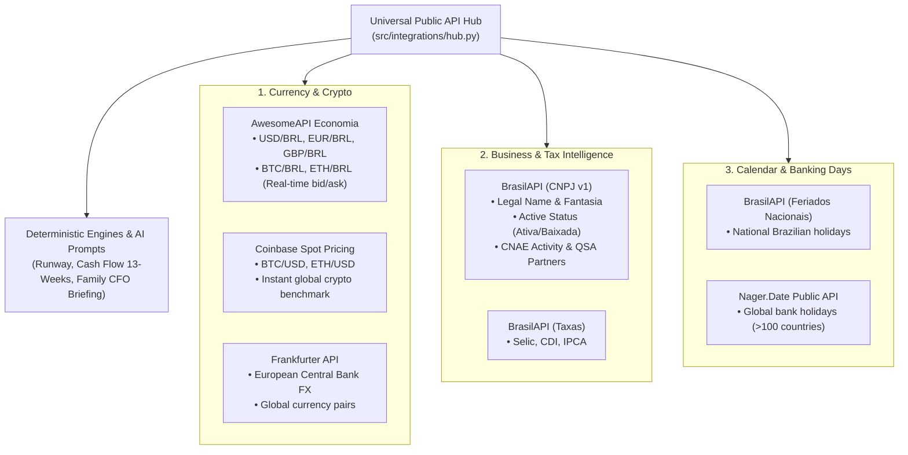

# Public APIs & External Data Integrations Specification

> **Technical Specification: Integration of Curated, Zero-Cost, Free Public APIs (from public-apis/public-apis) for Real-Time Financial Intelligence, Business Verification, Banking Calendars, and Currency/Crypto Tracking.**

---

## 1. Problem Statement & Motivation

To make sound financial recommendations, AI agents (such as the **Family CFO AI**, **Liquidity & Risk AI**, and **Growth & Pricing AI**) require more than historical ledger transactions:
1. **Real-Time FX & Multi-Currency**: Tracking exchange rates for the US Dollar (USD), Euro (EUR), and foreign consulting income without manual price lookups.
2. **Cryptocurrency & Liquid Alternatives**: Monitoring Bitcoin (BTC) and digital asset holdings as liquid reserves or portfolio hedges in BRL and USD.
3. **Business & Supplier Validation (CNPJ)**: Verifying the legal health, active status (*situação cadastral ativa*), trade name, and corporate partners (*QSA*) of clients and suppliers before extending credit or approving high-ticket services.
4. **Banking Calendar & Settlement Dates (Feriados Bancários)**: Accurately projecting cash flow and tax deadlines (DAS, boletos, receivables) by recognizing that due dates falling on weekends or public holidays roll over to the next banking business day.

Rather than relying on expensive subscription services, **OpenFamilyOffice** leverages curated, high-reliability, zero-auth public APIs cataloged in the open-source **[public-apis/public-apis](https://github.com/public-apis/public-apis)** ecosystem.

---

## 2. Integrated Public API Matrix

### Curated API Directory:

| Domain | Provider / API | Auth Required | Primary Endpoint | Use Case in OpenFamilyOffice |
|---|---|---|---|---|
| **Currency Exchange** | **AwesomeAPI Economia** | **None** (100% Free) | `https://economia.awesomeapi.com.br/last/USD-BRL,EUR-BRL,BTC-BRL` | Real-time FX rates, daily variation, bid/ask spreads. |
| **Global FX** | **Frankfurter API** | **None** (100% Free) | `https://api.frankfurter.app/latest` | European Central Bank reference exchange rates for global accounts. |
| **Cryptocurrency** | **Coinbase Spot** | **None** (100% Free) | `https://api.coinbase.com/v2/prices/spot?currency=USD` | Bitcoin and Ethereum spot prices in USD and BRL. |
| **Business / CNPJ** | **BrasilAPI (CNPJ)** | **None** (100% Free) | `https://brasilapi.com.br/api/cnpj/v1/{cnpj}` | Client credit check, vendor registration, active tax status verification. |
| **Bank Calendar** | **BrasilAPI (Feriados)** | **None** (100% Free) | `https://brasilapi.com.br/api/feriados/v1/{year}` | Brazilian banking settlement days; DAS due date rollover logic. |
| **Global Calendar** | **Nager.Date** | **None** (100% Free) | `https://date.nager.at/api/v3/PublicHolidays/{year}/{country}` | Worldwide banking holidays for international entities (US, UK, ES, DE). |

---

## 3. Business Logic & Agent Grounding

### 3.1. Banking Day Rollover (Feriados & Dias Úteis)
* Under Brazilian banking rules (Febraban / Receita Federal), if a tax deadline (such as the monthly **DAS MEI** due on the 20th) falls on a weekend or national bank holiday, the deadline is automatically postponed to the next banking business day.
* The `CalendarClient` inspects the holiday list and calculates whether an obligation is overdue or still within statutory grace.

### 3.2. Automated Client & Vendor CNPJ Auditing
* When a high-ticket contract is logged for *Fix Serviços* or *Facilita Vistorias*, the `BusinessClient` checks the client's CNPJ:
  * **Status Ativa**: Approved for standard contract billing.
  * **Status Inapta / Baixada / Suspensa**: High-Severity alert! The **Growth & Pricing AI** recommends demanding 100% upfront payment before beginning work.

### 3.3. Real-Time Multi-Currency Valuation
* For households holding foreign currencies (e.g. US bank accounts or digital assets), the `CurrencyClient` and `CryptoClient` convert all balances to the base currency (BRL) to maintain a live, consolidated net worth calculation.

---

## 4. Resilience & Fallback Guarantees

* **Zero Lock-In**: None of these APIs require subscription contracts or credit cards.
* **Network Fault Tolerance**: Every client implements a 5-second timeout and returns documented safe fallback rates if disconnected, ensuring offline operation is never blocked.
* **Local Caching**: Holiday lists and currency quotes are cached locally in `data/cache/` to eliminate redundant queries.
