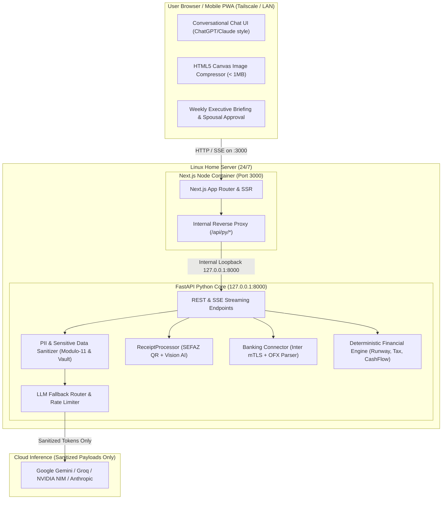

# Design Doc 03: Next.js Chat Interface, PII Sanitization, Mobile Receipt Capture & Banking Ingestion

**EGM Document ID**: `EGM-DESIGN-003`  
**Status**: **Approved by EGM Review (Hardened)**  
**Phase**: Phase 3 (Interactive Web & Banking Ingestion)  
**Primary Target Users**: Osmar & Vera (Household, Fix Serviços MEI, Facilita Vistorias MEI)  
**Infrastructure Target**: 24/7 Linux Home Server (Docker / Systemd, Local Network & Tailscale Access)  

---

## 1. Problem Statement & Operational Scope

1. **Mobile Friction**: Users need to snap receipt photos on their smartphone at the cash register and type simple guidance (e.g., *"usei o inter cnpj"* or *"foi almoço da obra da Fix"*), having the system route, categorize, and reconcile the transaction automatically.
2. **AI Chat Interface**: Instead of complex nested menus, the primary interface should feel like a dedicated private financial assistant (ChatGPT/Claude style), answering questions about cash flow, MEI ceilings, runway, and market conditions.
3. **Data Privacy & LGPD Invariant**: Real names, CPFs, account numbers, PIX keys, and trade names must NEVER be transmitted to external cloud LLMs. If numbers or amounts are sent to external APIs, they must be stripped of identifying personal links.
4. **Communication Cadence (ASD-STE100 ~80%)**: LLM chat outputs must eliminate traditional financial fluff, disclaimers, and rambling. Responses must be direct, short-sentenced, number-first, and operational.
5. **Banking Integration**: Automated statement ingestion from Banco Inter (official mTLS API) and universal OFX parsing for Nubank and Caixa Econômica Federal.

---

## 2. Technical Architecture & Component Boundaries



### 2.1 Technology Stack Decisions
* **Frontend**: Next.js 15 (App Router, TypeScript, Tailwind CSS, Lucide Icons, Mobile-first responsive PWA).
* **Backend**: FastAPI (Python 3.14 standard library + AnyIO). Binds strictly to `127.0.0.1:8000`.

### 2.2 Network Ingress, Reverse Proxy & Server Lifecycle Contract (Hardened)

1. **Next.js Server-Side Reverse Proxy**:
   - The browser client MUST NEVER connect directly to port 8000.
   - All browser requests target `/api/py/*` on port 3000. Next.js App Router rewrites route these requests internally to `http://127.0.0.1:8000/api/*`:
     ```typescript
     // next.config.ts
     const nextConfig = {
       async rewrites() {
         return [
           {
             source: '/api/py/:path*',
             destination: 'http://127.0.0.1:8000/api/:path*',
           },
         ];
       },
     };
     ```
   - FastAPI binds strictly to `127.0.0.1` (`--host 127.0.0.1`). This completely eliminates CORS preflight failures across Tailscale IP, MagicDNS, and LAN.

2. **SSE Streaming Contract**:
   - FastAPI SSE endpoints MUST emit headers:
     - `Content-Type: text/event-stream`
     - `Cache-Control: no-cache, no-transform`
     - `Connection: keep-alive`
     - `X-Accel-Buffering: no`
   - FastAPI SSE loops MUST send a heartbeat comment every 15 seconds: `yield ": ping\n\n"`.
   - Streaming chunks MUST carry monotonic event IDs (`id: <cursor>\ndata: <json>\n\n`).

3. **Container Resource & Process Limits**:
   - Docker Compose enforces strict memory caps and init process management (`init: true` to prevent zombie process leaks):
     ```yaml
     services:
       fastapi-core:
         image: openfamilyoffice-core:latest
         init: true
         deploy:
           resources:
             limits:
               memory: 1536M
         healthcheck:
           test: ["CMD", "curl", "-f", "http://127.0.0.1:8000/health"]
           interval: 10s
           timeout: 5s
           retries: 3
       web-dashboard:
         image: openfamilyoffice-web:latest
         init: true
         deploy:
           resources:
             limits:
               memory: 1024M
         depends_on:
           fastapi-core:
             condition: service_healthy
     ```

---

## 3. PII Sanitization & LGPD Masking Engine (Hardened)

### 3.1 Hardened PII Tokenization Engine
1. **Mandatory Modulo-11 Validation**:
   - Strings matching `\b\d{11}\b` or `\b\d{3}\.\d{3}\.\d{3}-\d{2}\b` are tested against the official Brazilian Modulo-11 algorithm. Only verified CPFs are masked (preventing corruption of timestamps, epochs, or transaction IDs).
   - Strings matching `\b\d{14}\b` or `\b\d{2}\.\d{3}\.\d{3}/\d{4}-\d{2}\b` are tested against the CNPJ Modulo-11 algorithm before masking.
2. **Heterogeneous PIX Key Sanitization**:
   - Redacts all 4 PIX key types:
     - CPFs/CNPJs
     - Phone numbers: `+55 (XX) 9XXXX-XXXX`
     - Email addresses: `\b[A-Za-z0-9._%+-]+@[A-Za-z0-9.-]+\.[A-Z|a-z]{2,}\b`
     - Random EVP keys: `\b[0-9a-f]{8}-[0-9a-f]{4}-[0-9a-f]{4}-[0-9a-f]{4}-[0-9a-f]{12}\b`
3. **Full Entity & Trade Name Vault**:
   - Redaction vault includes all trade names, legal names, and registered bank accounts to prevent quasi-identifier linkability attacks:
     ```python
     REDACTION_MAP = {
         "Osmar Henzen": "[PRINCIPAL_A]",
         "Vera Henzen": "[PRINCIPAL_B]",
         "Fix Serviços": "[ENTITY_01_MEI]",
         "Facilita Vistorias": "[ENTITY_02_MEI]",
         "osmar@fixservicos.com.br": "[PIX_EMAIL_01]",
     }
     ```
4. **Fuzzy Detokenization Regex**:
   - Detokenizer matches mutated tokens returned by LLMs:
     `r"\[?\s*(?:PRINCIPAL[_\s]A|ENTITY[_\s]01[_\s]MEI)\s*\]?"`
   - Replaces matches back with friendly local labels in the UI layer.
5. **Absolute Cloud Egress Guard**:
   - Sanitization is strictly enforced before all LLM calls.
   - When `FallbackRouter` shifts across providers, the egress client verifies that the sanitization pipeline executed. If unmasked PII is detected, the request is rejected immediately with `SecurityEgressException`.

---

## 4. Chat Assistant System Prompt Specification (ASD-STE100 ~80%)

Governed by [`prompts/09_chat_assistant_asd80.md`](../../prompts/09_chat_assistant_asd80.md):
1. **Short Sentences**: Maximum 15 to 20 words per sentence.
2. **Active Voice**: Mandatory ("O Bitcoin caiu 4%", never "Observou-se uma queda...").
3. **Number Before Narrative**: Lead with verified net figures (R$, US$, or %) before explaining context.
4. **One Fact Per Paragraph**: Bulleted lists and concise blocks.
5. **No Empty Disclaimers**: Omit boilerplate warnings ("o mercado oscila", "consulte um especialista").
6. **Zero Math by LLM Invariant**: Chat assistant MUST NOT perform mental arithmetic. Metrics are injected deterministically from `RunwayCalculator`, `MEITaxMonitor`, and `CashFlowForecastEngine`.

### Standard Response Layout
```markdown
- **Veredito Direto**: [Estado atual em 1 frase curta]
- **Métricas Chave**: [Valores em R$ / US$ / %]
- **Contexto Técnico Simples**: [Máximo 2 a 3 frases curtas]
- **Ação Prática Sugerida**: [Recomendação operacional objetiva]
```

---

## 5. Banking Ingestion Architecture (Banco Inter, Nubank, Caixa)

### 5.1 Banco Inter PJ mTLS Connector (Hardened)
* **Certificate Health**: On startup and daily at 06:00, parses client `.crt` and calculates days until expiration. If `days_remaining < 30`, raises alert `WARNING_MTLS_CERT_EXPIRING` in the dashboard.
* **OAuth2 Token Cache**: Caches access token with an in-memory TTL of 3300 seconds (55 min).
* **Request Windowing**: Queries are split into chunks of max 60 days (below the 90-day Inter limit).
* **Filter Unposted Operations**: Iterates over `extrato` response and discards any record where `tipoTransacao == "FUTURA"` or `status == "AGENDADO"` to prevent phantom expenses from distorting runway calculations.

### 5.2 Nubank & Caixa OFX Universal Dropzone (Hardened)
* **SGML-to-XML Pre-sanitizer**:
  - Pre-processes raw file by closing standard unclosed OFX tags (`<TRNTYPE>`, `<DTPOSTED>`, `<TRNAMT>`, `<FITID>`, `<MEMO>`) before passing to XML parser.
* **Date & Timezone Normalization**:
  - Parses regex `r"^(\d{4})(\d{2})(\d{2})(?:(\d{2})(\d{2})(\d{2}))?(?:\[.*\])?"` to cleanly handle Caixa's `[-3:BRT]` and Nubank's `YYYYMMDD`.
* **Credit Card (`<CCSTMTTRN>`) Support**:
  - Scans both `<BANKTRANLIST>` and `<CREDITCARDTRANLIST>`.
  - Normalizes debit/credit amounts based on `<TRNTYPE>` (`DEBIT` $\rightarrow$ negative Decimal; `CREDIT` $\rightarrow$ positive Decimal).
* **Composite Ingestion Deduplication**:
  - Ingestion computes an idempotency fingerprint:
    `fingerprint = sha256(f"{entity_code}|{account_id}|{date}|{amount}|{clean_memo}".encode()).hexdigest()`
  - Transactions matching an existing `fingerprint` are skipped with `SKIPPED_DUPLICATE`.

---

## 6. Mobile Receipt Capture & Human-in-the-Loop Rollback (Hardened)

### 6.1 Client-Side Compression
* Next.js receipt upload component downscales images via HTML5 Canvas before transmission:
  - Max dimension: 1600px (width or height).
  - Format: WebP (quality 0.8) or JPEG.
  - Hard payload limit: < 1.0 MB.

### 6.2 Staged Receipt State Machine
```
[UPLOADED] ---> [OCR_EXTRACTED] ---> [NEEDS_CLARIFICATION] (if entity ambiguous)
                       |                       |
                       | (entity resolved)     v
                       +---------------> [AWAITING_MATCH]
                                               |
                                               v
                                       [MATCHED_TO_BANK]
```
* Ambiguous submissions (e.g. *"dividir entre casa e fix"*) enter `NEEDS_CLARIFICATION` and are stored in `data/ledger/staged_receipts.json` with a 72-hour TTL.

### 6.3 Atomic Rollback & Unmatch API
* `POST /api/receipts/{receipt_id}/unmatch`:
  - Restores matched `Transaction` to `status = CONFIRMED`.
  - Strips `[RECEIPT_ATTACHED: ...]` from transaction notes.
  - Sets `Receipt` status back to `PENDING_BANK_MATCH` and sets `matched_transaction_id = None`.
  - Appends an audit event to `data/governance/reconciliation_audit.log`.

---

## 7. Spousal Dual-Key Approval Interface (Osmar & Vera)

The web dashboard provides an explicit approval panel for the weekly briefing:
* **Weekly Action Items**: Checkboxes requiring confirmation before actions are marked done.
* **Dual-Key Requirements**: Decisions tagged `[JOINT_APPROVAL]` require two distinct clicks:
  * `[ ] Aprovado por Osmar`
  * `[ ] Aprovado por Vera`
* **Persistent Audit Log**: Stored locally in `data/governance/approvals.json`.
