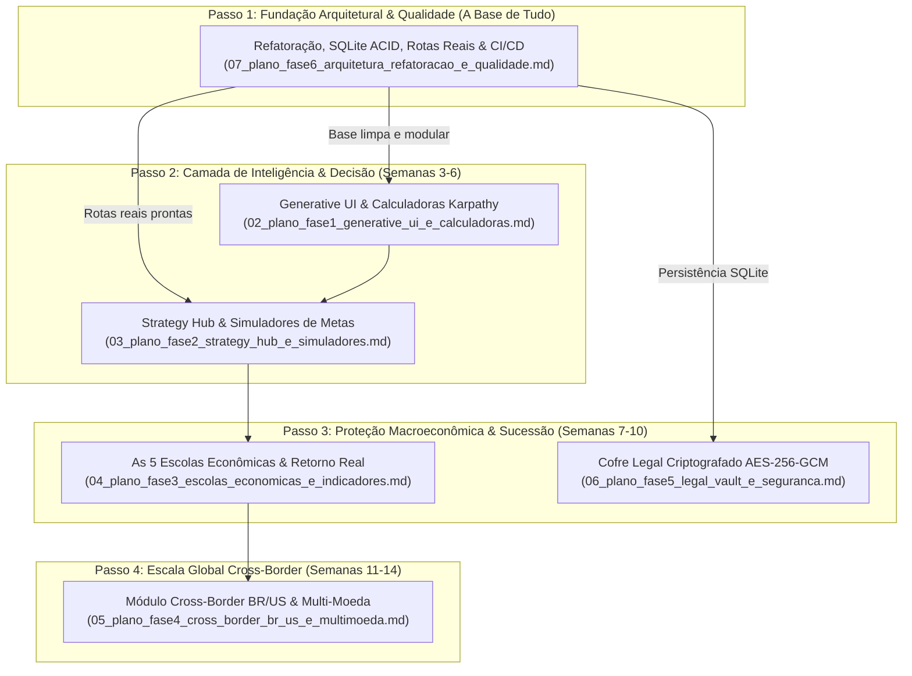

# Plano Mestre e Roteiro Estratégico de Implementação
## OpenFamilyOffice: Transformação em Gabinete de Inteligência Familiar Multigeracional

> **Arquivo de Coordenação Geral:** `references/melhorias/01_plano_mestre_roadmap_estrategico.md`  
> **Data de Emissão:** Novembro de 2026 (Atualizado com Abordagem Foundation-First)  
> **Status:** Aprovado para Execução Faseada  
> **Diretiva de Operação:** Planejamento Exaustivo e Estruturado (Sem codificação nesta etapa)

---

## 1. Visão Geral da Estratégia de Evolução: Por que a Refatoração é o Passo 1

Na engenharia de software tradicional, existem duas abordagens para evolução de sistemas legados:
1. **Abordagem *Feature-First* (Ingênua)**: Construir novas telas e recursos visuais chamativos por cima de um monólito instável.
2. **Abordagem *Foundation-First* (Engenharia Sólida — Recomendada)**: **"Preparar o terreno primeiro"**. Desacoplar os monólitos, estabelecer a camada de banco de dados ACID e ativar o CI/CD antes de construir qualquer tela nova.

Construir a Generative UI, o Strategy Hub (`/strategy`), o Cofre Legal (`/vault`) e o Módulo Cross-Border em cima do monólito atual ([`page.tsx`](file:///j:/Arquivos%20Osmar/OpenFamilyOffice/web/app/page.tsx) com **2.664 linhas e 40+ `useState`**, e [`api.py`](file:///j:/Arquivos%20Osmar/OpenFamilyOffice/src/web/api.py) com **1.696 linhas**) inflaria a complexidade a níveis insustentáveis, provocando colisões de estado e lentidão de renderização.

Portanto, **a Refatoração Arquitetural, Migração SQLite ACID e CI/CD (antigo arquivo 07) é formalmente o PASSO 1 (Marco Zero / Fundação Estrutural)**.

---

## 2. Por que Refatorar Antes Multiplica a Velocidade das Fases Seguintes?

| Área Impactada | Se Implementássemos as Novas Funcionalidades Antes | Com a Refatoração Feita no Passo 1 (Correto) |
| :--- | :--- | :--- |
| **Strategy Hub (`/strategy`)** | Teríamos que criar mais um modal pesado de 1.000 linhas dentro de `page.tsx`, levando o arquivo a quase 4.000 linhas e tornando o carregamento lento. | O Strategy Hub nasce como uma **página dedicada e isolada** no Next.js App Router (`web/app/strategy/page.tsx`), limpa e rápida. |
| **Backend Endpoints** | Os novos endpoints de simuladores, cofre e câmbio inflariam `api.py` para além de 3.000 linhas de código confuso. | Cada nova funcionalidade entra como um **módulo independente** em `src/web/routers/` (`strategy_router.py`, `vault_router.py`, etc.). |
| **Persistência de Dados** | Novos recursos gerariam mais arquivos planos JSON soltos em disco, que teriam que ser migrados no futuro com risco de inconsistência. | Todos os novos recursos já nascem salvando em **tabelas SQLite com chaves estrangeiras, índices e transações atômicas ACID**. |
| **Segurança e Testes** | Qualquer alteração no código atual correria risco de quebrar os 111 testes sem que ninguém percebesse até o teste manual. | O **GitHub Actions roda automaticamente** em cada commit, bloqueando bugs antes que atinjam o branch principal. |

---

## 3. Matriz de Priorização e Sequência de Execução

| Ordem de Execução | Frente de Trabalho | Arquivo do Plano | Justificativa de Engenharia | Prioridade |
| :---: | :--- | :--- | :--- | :---: |
| **1º** | **Refatoração, SQLite ACID & CI/CD** | [`07_plano_fase6_arquitetura_refatoracao_e_qualidade.md`](07_plano_fase6_arquitetura_refatoracao_e_qualidade.md) | **A Base de Tudo**: Cria as rotas Next.js, modulariza `api.py`, cria o banco SQLite e ativa o CI/CD. | **P0 (Mandatória)** |
| **2º** | **Generative UI & Calculadoras Vivas** | [`02_plano_fase1_generative_ui_e_calculadoras.md`](02_plano_fase1_generative_ui_e_calculadoras.md) | Transforma o chat com componentes interativos (sliders Karpathy) já plugados no router modular. | **P0 (Imediata)** |
| **3º** | **Strategy Hub & Simuladores de Metas** | [`03_plano_fase2_strategy_hub_e_simuladores.md`](03_plano_fase2_strategy_hub_e_simuladores.md) | Cria a rota `/strategy` (TCO de carro, casa vs aluguel, radar proativo) com tabelas SQLite prontas. | **P0 (Imediata)** |
| **4º** | **As 5 Escolas Econômicas & Retorno Real** | [`04_plano_fase3_escolas_economicas_e_indicadores.md`](04_plano_fase3_escolas_economicas_e_indicadores.md) | Filtro de ganho real líquido (IPCA), Colchão Comportamental 2-5a e Hard Asset Ratio no dashboard. | **P1 (Curto Prazo)** |
| **5º** | **Cofre Legal Criptografado & Sucessão** | [`06_plano_fase5_legal_vault_e_seguranca.md`](06_plano_fase5_legal_vault_e_seguranca.md) | Cria a rota `/vault` com proteção militar AES-256-GCM para escrituras e protocolo sucessório. | **P1 (Curto Prazo)** |
| **6º** | **Cross-Border BR/US & Multi-Moeda** | [`05_plano_fase4_cross_border_br_us_e_multimoeda.md`](05_plano_fase4_cross_border_br_us_e_multimoeda.md) | Toggle BRL/USD/Dual, conversão PTAX, instrumentos US (401k, Roth IRA, HSA) e regras fiscais. | **P2 (Médio Prazo)** |

---

## 4. Guia de Navegação dos Planos de Implementação

Todos os documentos estão disponíveis na pasta [`references/melhorias/`](file:///j:/Arquivos%20Osmar/OpenFamilyOffice/references/melhorias):

1. [`00_analise_geral_e_diagnostico_do_sistema.md`](00_analise_geral_e_diagnostico_do_sistema.md): Diagnóstico exaustivo do backend, frontend, segurança e dados atuais.
2. [`01_plano_mestre_roadmap_estrategico.md`](01_plano_mestre_roadmap_estrategico.md): Este documento (Governança geral e alinhamento sequencial Foundation-First).
3. [`07_plano_fase6_arquitetura_refatoracao_e_qualidade.md`](07_plano_fase6_arquitetura_refatoracao_e_qualidade.md): **Executar Primeiro** — Decomposição de `page.tsx` e `api.py`, SQLite local com WAL/ACID, rotas dedicadas e CI/CD.
4. [`02_plano_fase1_generative_ui_e_calculadoras.md`](02_plano_fase1_generative_ui_e_calculadoras.md): Renderização de artefatos interativos Karpathy no chat (Juros Compostos, Custo de Oportunidade, Retorno Real com IPCA).
5. [`03_plano_fase2_strategy_hub_e_simuladores.md`](03_plano_fase2_strategy_hub_e_simuladores.md): Tela central de Estratégias & Decisões, simuladores de metas (Carro TCO, Casa vs Aluguel, Celular) e radar proativo de oportunidades.
6. [`04_plano_fase3_escolas_economicas_e_indicadores.md`](04_plano_fase3_escolas_economicas_e_indicadores.md): Motor das 5 Escolas Econômicas (Hard Asset Ratio, Colchão Comportamental 2-5a, Cooling-Off Lock, Ganho Real Mandatório).
7. [`06_plano_fase5_legal_vault_e_seguranca.md`](06_plano_fase5_legal_vault_e_seguranca.md): Cofre documental criptografado localmente (AES-256-GCM) para escrituras, contratos sociais, apólices e protocolo de sucessão familiar.
8. [`05_plano_fase4_cross_border_br_us_e_multimoeda.md`](05_plano_fase4_cross_border_br_us_e_multimoeda.md): Módulos regionais Brasil, Expatriado e US Nativo (BRL/USD com PTAX, 401k, Roth IRA, HSA, W-8BEN, Carnê-Leão e IRS 1040).

---

## 5. Princípios de Engenharia Mandatórios Durante a Execução

Ao iniciar a execução prática pelo **Passo 1 (Refatoração)**, as seguintes regras são inegociáveis:

1. **Migração com Validação de Centavos**: A migração de `transactions.csv` para SQLite deve validar que a soma de saldos das 1.149 transações reais é idêntica até o último centavo.
2. **Nenhuma Quebra nos 111 Testes Existentes**: Todos os 111 testes em `tests/` devem permanecer 100% aprovados durante e após a quebra de `api.py` em routers menores.
3. **Preservação Visual Absoluta**: A extração de componentes de `page.tsx` para `web/app/components/dashboard/` não pode alterar nenhum pixel ou estilo visual do design executivo atual.
