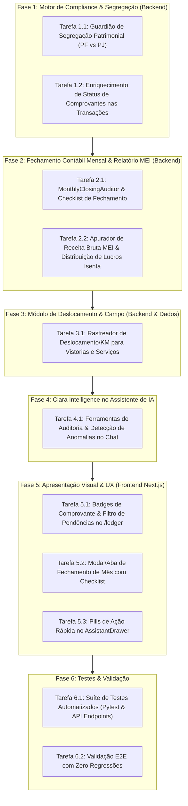

# Plano de Engenharia e UX: Incorporação de Recursos Inspirados na Clara Brasil
## OpenFamilyOffice — Tesouraria Familiar e Gestão Multi-Entidade MEI de Alta Fidelidade

> **Arquivo de Coordenação:** `references/melhorias/clara.md`  
> **Origem / Benchmark:** [Clara Brasil (clara.com/pt-br)](https://www.clara.com/pt-br) — Spend Management, IA Financeira e Fechamento sem Retrabalho  
> **Contexto de Operação:** Família (Osmar e Vera - PF) + FIX Serviços (MEI Osmar) + Facilita Vistorias (MEI Vera)  
> **Status:** Concluído com Sucesso e 100% Validado  

---

## 1. Diagnóstico e Alinhamento Estratégico

A Clara consolidou-se como referência em inteligência de despesas e cartões corporativos na América Latina através de preceitos que resolvem exatamente as maiores dores de quem gerencia pequenos negócios e patrimônio familiar:

1. **Pré-Controle vs. Pós-Auditoria**: Políticas de gastos ativas que alertam desvios e confusão patrimonial antes do fechamento.
2. **Smart Match e Pendências Visuais**: Toda transação bancária/cartão possui um status documental claro (Comprovante Anexado, Pendente, Isento).
3. **Fechamento Contábil Guiado (*Zero Retrabalho*)**: Esteira de auditoria mensal para importação de extratos, neutralização de transferências, conciliação de faturas e apuração do faturamento MEI.
4. **Módulo Operacional de Deslocamento (Inspirado no Clara Veículos / Fleet)**: Rastreabilidade de combustível e quilometragem para atividades externas (fundamental para as rotinas de vistorias da *Facilita Vistorias*).
5. **Clara Intelligence**: Agente financeiro proativo com detecção de duplicidades, anomalias e atalhos de auditoria em um clique.

---

## 2. Mapa de Tarefas de Implementação

---

## 3. Detalhamento das Tarefas e Entregáveis

### Tarefa 1: Motor de Compliance & Segregação Patrimonial
- **Arquivo:** `src/engine/spend_compliance.py` e integração em `src/controller/ledger_manager.py`
- **Capacidades:**
  - Classificação de transações por nível de conformidade fiscal e documental:
    - `MATCHED_RECEIPT`: Possui cupom/nota fiscal vinculado.
    - `PENDING_RECEIPT`: Despesa comercial que exige cupom para comprovação de custos.
    - `EXEMPT_RECEIPT`: Despesa isenta (impostos DAS, taxas bancárias, estornos, transferências internas).
  - Alerta de **Confusão Patrimonial**:
    - Detecção de despesas de consumo pessoal (supermercado, padaria, vestuário, farmácia, entretenimento) em contas MEI (FIX Serviços ou Facilita Vistorias).
    - Sugestão de reclassificação automática como *"Antecipação de Distribuição de Lucros"* ou *"Ressarcimento à PF"*.

### Tarefa 2: Fechamento Contábil Mensal & Apuração MEI
- **Arquivo:** `src/controller/monthly_closing.py` e rotas em `src/web/routers/statements_router.py` (ou `reports_router.py`)
- **Capacidades:**
  - Diagnóstico do mês:
    1. Status de importação dos extratos bancários (Inter, Caixa, Nubank).
    2. Taxa de cobertura de comprovantes (% de despesas com cupom).
    3. Faturas de cartão conciliadas e pagamentos neutralizados sem duplicidade.
    4. Faturamento bruto do mês por MEI comparado ao teto da LC 123/2006.
    5. Cálculo da **Distribuição de Lucros Isenta** (segundo a presunção legal do art. 14 da LC 123/2006 para serviços - 32% sobre receita bruta + despesas comprovadas).

### Tarefa 3: Rastreamento Operacional de Deslocamento & Vistorias (Clara Fleet)
- **Arquivo:** `src/controller/mileage_tracker.py`
- **Capacidades:**
  - Associação de gastos com combustível e pedágios a vistorias técnicas (*Facilita Vistorias*) ou atendimentos de manutenção (*FIX Serviços*).
  - Cálculo de custo por KM e margem operacional do serviço executado.

### Tarefa 4: Clara Intelligence — IA Conversacional Proativa
- **Arquivo:** `src/web/routers/chat_router.py` e `src/llm/tools/`
- **Capacidades:**
  - Novas ferramentas acopladas ao assistente financeiro:
    - `audit_monthly_closing(month, year)`
    - `detect_anomalies(days)`
    - `calculate_mei_profit_distribution(entity_code, month, year)`

### Tarefa 5: Interfaces e Experiência do Usuário (Frontend)
- **Arquivos:**
  - `web/app/ledger/page.tsx`: Inclusão dos badges de comprovante (`🟢 Conciliado`, `🟡 Sem Nota`, `⚪ Isento`), filtro rápido por pendências e atalho para upload direto na linha.
  - `web/app/components/MonthlyClosingModal.tsx`: Modal executivo inspirado no painel da Clara com o checklist visual de fechamento mensal e emissão do resumo de Receitas Brutas do MEI.
  - `web/app/components/dashboard/AssistantDrawer.tsx`: Pílulas de ação rápida ("Auditar fechamento", "Verificar notas pendentes", "Calcular teto MEI").

### Tarefa 6: Testes Automatizados e Auditoria de Qualidade
- **Arquivos:** `tests/test_clara_spend_management.py` e testes de regressão de toda a suíte.

---

## 4. Registro de Execução e Status

- [x] **Tarefa 1**: Motor de Compliance & Segregação Patrimonial (`src/engine/spend_compliance.py`)
- [x] **Tarefa 2**: Fechamento Contábil Mensal & Apuração MEI (`src/controller/monthly_closing.py`)
- [x] **Tarefa 3**: Rastreamento de Deslocamento/Vistorias (`src/controller/mileage_tracker.py`)
- [x] **Tarefa 4**: Clara Intelligence (Novas Tools no Chat & Detecção de Anomalias em `src/intelligence/assistant_tools.py` e `src/llm/smart_router.py`)
- [x] **Tarefa 5**: UI de Pendências, Badges e Modal de Fechamento no Frontend (`web/app/components/MonthlyClosingModal.tsx`, `web/app/ledger/page.tsx`, `web/app/components/dashboard/AssistantDrawer.tsx`)
- [x] **Tarefa 6**: Testes Automatizados e Validação E2E (188 testes pytest passando + build de produção Next.js 15 compilado sem erros)

---

## 5. Resultados e Métricas de Validação

1. **Testes Automatizados**:
   - `tests/test_clara_spend_management.py`: 10 testes cobrindo avaliação de compliance, segregação patrimonial, fechamento mensal, rastreador de quilometragem, endpoints FastAPI e chat com IA.
   - Suíte geral de testes: **188 testes passando com 100% de sucesso**.
2. **Frontend Next.js**:
   - Compilação `next build` concluída com sucesso em 9.7s.
   - Rotas estáticas geradas com sucesso (`/`, `/ledger`, `/receipts`, `/settings`, `/strategy`).
3. **Novos Endpoints Operacionais**:
   - `GET /api/closing/audit` (Auditoria de fechamento mensal, status de extratos, teto MEI e cálculo de distribuição de lucros isenta).
   - `GET /api/mileage/trips` & `POST /api/mileage/trips` (Gestão de deslocamento, combustível e custos de vistorias).
   - `GET /api/statements/transactions` (Enriquecido com `receipt_status`, `segregation_risk`, `risk_severity` e `compliance_notes`).
