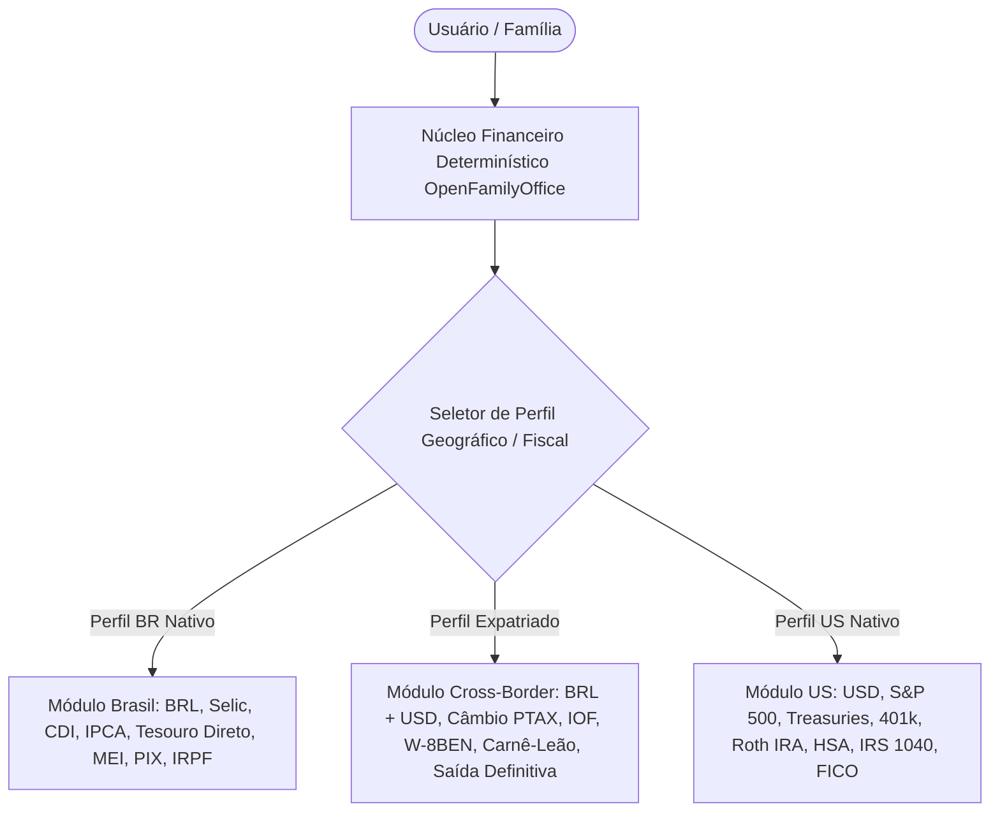
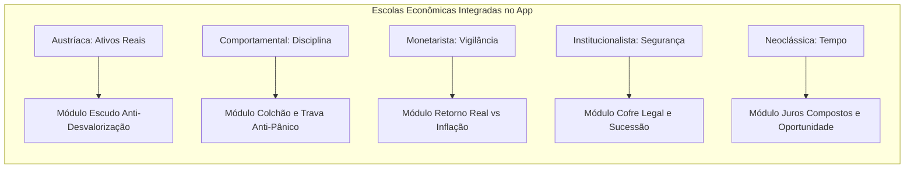
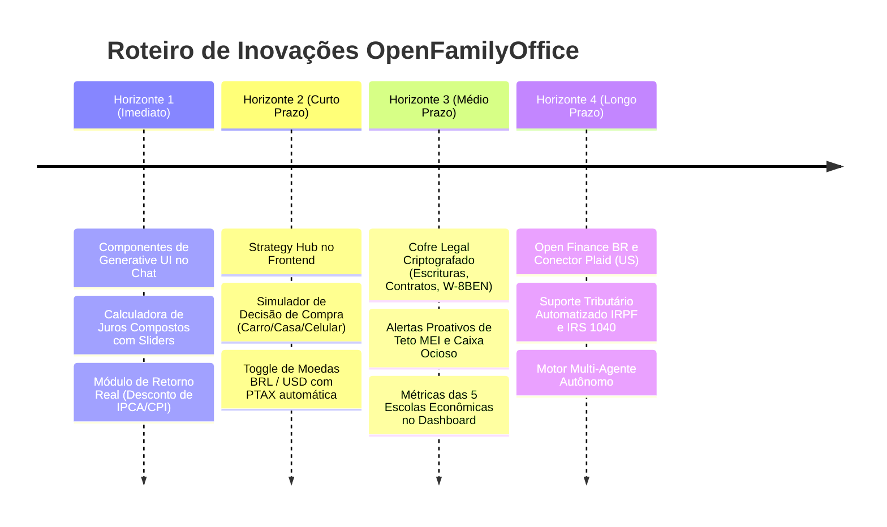

# Pesquisa de Mercado, Inovações e Plano Diretor de Funcionalidades
## OpenFamilyOffice: Da Gestão Patrimonial Familiar à Inteligência Financeira Multigeracional

> **Arquivo de Referência:** `references/melhorias/pesquisa-melhorias.md`  
> **Data de Elaboração:** Novembro de 2026  
> **Status:** Aprovado para Planejamento e Especificação Técnica  
> **Público-Alvo:** Família Multigeracional (Brasil e Exterior), Brasileiros Expats / Nômades, Nativos Americanos (US)

---

## 1. Sumário Executivo

O **OpenFamilyOffice** nasceu como um sistema de tesouraria privada local-first, desenhado com rigor determinístico para separar contas de Pessoa Física (PF) e Pessoa Jurídica (MEI/Pequenas Empresas), conciliando comprovantes fiscais (NFC-e/OCR) e garantindo privacidade total.

O mercado de tecnologia financeira pessoal e familiar atingiu uma bifurcação decisiva:
1. **Aplicativos de orçamento convencionais** (como YNAB, Organizze e Mobills) continuam restritos a registrar despesas passadas ("olhar no retrovisor") com pouca orientação prospectiva de riqueza.
2. **Consolidadores de grandes patrimônios** (como Kubera e Addepar) monitoram balanços globais, mas ignoram o dia a dia operacional da família e a rotina de compras.
3. **Plataformas de IA emergentes** (como Origin e Copilot Money) começam a oferecer insights preditivos, mas ainda operam como chatbots de texto estático, sem interfaces interativas sob demanda (*Generative UI*).

Este documento sintetiza uma pesquisa de mercado abrangente nos ecossistemas do Brasil e dos Estados Unidos, fundamenta a transformação do OpenFamilyOffice através de **5 grandes escolas de pensamento econômico comprovadas**, projeta uma **Camada de Inteligência Estratégica com UI Generativa (modelo Andrej Karpathy)** e estabelece um roteiro prático para tornar a aplicação indispensável tanto para uma família brasileira quanto para residentes nos EUA.

---

## 2. Benchmarking Global e Análise Comparativa de Mercado

Para mapear com precisão as lacunas de mercado e as melhores práticas, foram auditadas as principais referências de software financeiro no Brasil e nos EUA.

### Matriz Comparativa de Funcionalidades

| Plataforma | Foco Principal | Gestão Familiar / Multi-Entidade | Suporte Cross-Border (BR/US) | Abordagem com IA | Modelo de Visualização | Limitações Críticas |
| :--- | :--- | :--- | :--- | :--- | :--- | :--- |
| **Monarch Money** (EUA) | Orçamento colaborativo para casais e patrimônio líquido | ⭐⭐⭐⭐⭐ (Excelente colaboração a dois, contas compartilhadas) | ⭐⭐ (Foco quase exclusivo em US/Canadá via Plaid/Finicity) | ⭐⭐⭐ (Categorização inteligente de transações) | Dashboards modulares e gráficos limpos | Sem suporte a moedas emergentes, sem segregação PJ/MEI, sem cálculos fiscais do Brasil. |
| **Copilot Money** (EUA) | UX premium e inteligência preditiva (iOS/Mac) | ⭐⭐ (Foco estrito no indivíduo; sem multiusuário robusto) | ⭐ (Exclusivo contas americanas) | ⭐⭐⭐⭐ (Machine learning local apurado para categorias e despesas recorrentes) | Gráficos modernos de fluxo de caixa e P&L | Preso ao ecossistema Apple; não atende estrutura familiar ou pequenos negócios. |
| **Kubera** (Global) | Consolidação de balanço patrimonial para alta renda | ⭐⭐⭐ (Dead Man's Switch / herdeiros, mas sem visão orçamentária) | ⭐⭐⭐⭐⭐ (Multi-moeda nativo, bancos globais, cripto, imóveis, ouro, startups) | ⭐ (Zero IA conversacional; totalmente analítico) | Planilha executiva dinâmica estilo Bloomberg/Family Office | Custo elevado ($250/ano), zero controle de gastos cotidianos ou cupons fiscais. |
| **YNAB** (You Need A Budget) | Orçamento de base zero ("Give every dollar a job") | ⭐⭐⭐ (YNAB Together para até 6 pessoas da família) | ⭐⭐ (Monetário mono-moeda por orçamento) | ⭐ (Regras estritas determinísticas; sem IA preditiva) | Tabela hierárquica por envelopes orçamentários | Curva de aprendizado íngreme; não gerencia investimentos, ações ou proteção patrimonial. |
| **Origin Financial** (EUA) | Gestão patrimonial holística para profissionais de tecnologia | ⭐⭐⭐ (Foco no titular e dependentes; plano de previdência) | ⭐ (Restrito aos EUA) | ⭐⭐⭐⭐ (Copiloto com IA integrado a planejadores humanos CFP) | Gráficos de projeção patrimonial e equity/RSU | Fechado para o mercado dos EUA e dependente de pacotes corporativos de benefícios. |
| **Mobills** (Brasil) | Orçamento pessoal e cartões de crédito no Brasil | ⭐⭐⭐ (Gestão familiar via compartilhamento de orçamento) | ⭐ (Focado em BRL e Open Finance nacional) | ⭐⭐ (Assistente simples de categorização) | Gráficos de rosca e barras tradicionais | Excesso de anúncios e gamificação; fraco em patrimônio consolidado e dólar. |
| **Organizze** (Brasil) | Controle de gastos simplificado e offline-first | ⭐⭐ (Controle de contas conjuntas, mas sem entidades PJ) | ⭐ (Apenas contas brasileiras) | ⭐ (Nenhum recurso de IA generativa) | Minimalista, foco em saldo de contas e faturas | Não faz cálculo de rentabilidade real, nem projeções de juros compostos. |
| **Kinvo / Gorila** (Brasil) | Consolidação de investimentos e acompanhamento de proventos | ⭐⭐ (Visão única do CPF, sem tesouraria familiar mista) | ⭐⭐⭐ (Integração B3 e ativos no exterior com cotação) | ⭐⭐⭐ (Gorila AI para tirar dúvidas da carteira) | Gráficos de pizza por classe de ativo e gráficos de rentabilidade vs CDI/IPCA | Não controlam despesas operacionais do dia a dia; desconectados do fluxo de caixa. |
| **Wise / Nomad / Avenue** (Cross-Border) | Banking internacional e corretagem global para brasileiros | ⭐⭐ (Uso pessoal; contas separadas) | ⭐⭐⭐⭐⭐ (Câmbio comercial, IOF, conversão BRL/USD, W-8BEN) | ⭐ (Puramente transacional) | Extratos de conta corrente e relatórios fiscais básicos | Não são sistemas de gestão patrimonial integrada; são provedores de custódia. |

---

## 3. O Fator Diferencial: Adaptação Cultural e Flexibilidade Transfronteiriça (BR / US)

Para que o OpenFamilyOffice funcione com perfeição tanto para um **brasileiro no Brasil**, um **brasileiro expatriado nos EUA** quanto para um **americano nativo**, a arquitetura precisa desacoplar a lógica financeira de idiossincrasias locais, operando com **módulos regionais intercambiáveis**.



### 3.1. Caso de Uso 1: O Brasileiro no Brasil
* **Realidade Econômica:** Inflação crônica volátil, juros nominais elevados (Selic/CDI a dois dígitos), alta complexidade tributária (IRPF, MEI, Simples Nacional).
* **Instrumentos Essenciais:** 
  * PIX automático e conciliação de comprovantes com chave QR-Code NFC-e.
  * Comparativo automático de rendimentos contra **CDI líquido** e **IPCA acumulado**.
  * Monitoramento do teto de faturamento MEI (LC 123/2006 e LC 238/2026: faixas de R$ 81k, R$ 110k, R$ 140k).
  * Acompanhamento de FGTS, Tesouro Selic, Tesouro IPCA+ e cotas de Fundos Imobiliários (FIIs) com proventos isentos.

### 3.2. Caso de Uso 2: O Brasileiro nos EUA / Expatriado (Cross-Border)
* **Realidade Econômica:** Receitas em dólar ou remessas regulares Brasil $\leftrightarrow$ EUA; risco cambial duplo; indefinição de residência fiscal.
* **Instrumentos Essenciais:**
  * **Dupla Moeda Simultânea:** Visualização do patrimônio com toggle instantâneo entre BRL e USD, usando a taxa PTAX oficial do Banco Central.
  * **Painel Fiscal de Remessas:** Cálculo de spread bancário e IOF em operações via Wise, Nomad, Avenue ou Remessa Online.
  * **Conformidade Fiscal Cruzada:** Suporte aos formulários W-8BEN (retenção de 30% em dividendos de ações americanas para não residentes), declaração de Saída Definitiva do País (DSPD) versus Dupla Residência Fiscal, e radar para o Carnê-Leão e declaração de Capitais Brasileiros no Exterior (CBE Bacen para patrimônios acima de US$ 1 milhão).

### 3.3. Caso de Uso 3: O Americano Nativo (US Native)
* **Realidade Econômica:** Moeda de reserva global (USD), cultura forte de mercado de capitais acionário, instrumentos previdenciários e de saúde com benefícios fiscais agressivos.
* **Instrumentos Essenciais:**
  * **Tax-Advantaged Accounts:** Rastreamento estruturado de **401(k)** (com cálculo de employer match), **Roth IRA** vs **Traditional IRA**, e **HSA** (Health Savings Account - o "triple tax advantage").
  * **High-Yield Savings Accounts (HYSA):** Monitoramento de reserva de emergência rendendo taxas de Federal Funds (4,5% a 5,5% a.a.) seguradas pelo FDIC.
  * **Crédito e Dívida:** Acompanhamento do FICO Credit Score, tabela de amortização de financiamento imobiliário (*Fixed-rate 15/30-year Mortgage*) e refinanciamento de empréstimos estudantis.
  * **Conformidade IRS:** Registro de transações com classificação para o Formulário 1040 (Schedule D para ganhos de capital de curto e longo prazo - Short-Term vs Long-Term Capital Gains).

---

## 4. O Alicerce Filosófico e Econômico: Protegendo e Multiplicando o Patrimônio

O OpenFamilyOffice não deve ser apenas uma ferramenta de registro passivo, mas um **mentor financeiro ativo**. A maioria das famílias empobrece não por falta de renda, mas por falta de um arcabouço conceitual sólido contra a inflação, os impostos, os litígios e os próprios impulsos humanos.

Integrando os princípios das cinco grandes escolas de pensamento econômico, transformamos teorias consagradas em **regras de software, alertas automáticos e indicadores visuais**:



### 4.1. Escola Austríaca (Mises, Hayek): Escudo contra a Desvalorização da Moeda
* **O Princípio:** Moedas fiduciárias emitidas sem lastro sofrem desvalorização contínua pelo efeito Cantillon e expansão de crédito dos bancos centrais. A verdadeira riqueza está na poupança real e na posse de **Hard Assets** (ativos escassos que nenhum governo pode imprimir).
* **Implementação no OpenFamilyOffice:**
  * **Indicador "Hard Asset Ratio":** Métrica percentual que exibe quanto do patrimônio familiar está alocado em ativos reais (ouro físico, prata, imóveis próprios, terras, participações societárias em empresas produtivas e ativos de suprimento fixo como Bitcoin) contra depósitos fiduciários em papel-moeda.
  * **Alerta de Perda de Soberania Monetária:** Notificação silenciosa quando a liquidez fiduciária pura (saldos em conta corrente que não rendem) ultrapassa o limite recomendado para a operação de curto prazo.
  * **Aversão a Dívidas Destrutivas:** O app sinaliza com badge vermelho qualquer dívida de consumo ou rotativo de cartão, evidenciando a transferência ilegítima de riqueza futura para bancos.

### 4.2. Economia Comportamental (Kahneman, Tversky, Thaler): Domando o "Inimigo Interno"
* **O Princípio:** O maior destruidor de patrimônio não é o mercado em baixa, mas a psicologia do indivíduo: aversão à perda (que leva a vender no fundo em pânico), contabilidade mental (gastar dinheiro de restituição como se não fosse fruto de trabalho) e viés do presente (privilegiar o prazer imediato sobre o conforto futuro).
* **Implementação no OpenFamilyOffice:**
  * **Colchão de Amortecimento de 2 a 5 Anos de Despesas Essenciais:** Em vez de uma reserva de apenas 6 meses, o sistema permite definir e acompanhar um "Colchão de Tranquilidade Comportamental". Saber que o sustento da família está garantido por anos blinda o investidor contra o pânico de liquidar ações ou imóveis em momentos de baixa do mercado.
  * **Mecanismo de "Cooling-Off" (Período de Reflexão para Compras):** Ao cogitar compras de alto valor (como trocar de celular ou comprar um carro), o app cria um bloqueio psicológico deliberado com um timer de 7 a 30 dias, mostrando o custo de oportunidade antes de autorizar o gasto no planejamento.
  * **Arquitetura de Escolha Nudge:** Configuração de aportes automáticos programados para o dia seguinte ao recebimento do salário ou pró-labore ("Pague-se primeiro"), eliminando a dependência de força de vontade.

### 4.3. Escola Monetarista e de Chicago (Milton Friedman): Vigilância da Inflação e Retorno Real
* **O Princípio:** "A inflação é sempre e em qualquer lugar um fenômeno monetário". Ganhos nominais são uma ilusão de ótica que esconde a corrosão do poder de compra real.
* **Implementação no OpenFamilyOffice:**
  * **Filtro Mandatório de Rentabilidade Real:** O aplicativo **proíbe a exibição de rentabilidade puramente nominal** sem o devido ajuste inflacionário. Se uma aplicação de renda fixa rendeu 12% ao ano no Brasil, mas o IPCA foi de 6%, o destaque principal da tela é o ganho real de **+5,66%**.
  * **Monitor de Poder de Compra:** Um gráfico histórico que não mede o patrimônio apenas em reais ou dólares nominais, mas em **cestas de consumo essenciais** (ex: quantidade de cestas básicas, valor médio do m² de habitação, mensalidades escolares ou barris de petróleo que o patrimônio da família é capaz de adquirir ao longo dos anos).

### 4.4. Economia Institucionalista (Douglass North): Segurança Jurídica e Proteção Patrimonial
* **O Princípio:** Mercados e poupança só florescem sob instituições sólidas, respeito a contratos e direitos de propriedade inequívocos. A falta de documentação formal e estrutura jurídica expõe o patrimônio a confiscos, litígios familiares, bloqueios judiciais e perdas brutais no inventário.
* **Implementação no OpenFamilyOffice:**
  * **Cofre Legal & Documental (Legal Vault):** Repositório local criptografado para armazenar escrituras públicas de imóveis, contratos sociais de MEI/LTDA/LLC, certidões de casamento com pacto antenupcial, apólices de seguro de vida e termos de quitação de dívidas.
  * **Protocolo de Sucessão e Herança:** Checklist institucional para transição de patrimônio: status de testamento, indicação clara de beneficiários em contas bancárias/planos 401k/VGBL, procurações médicas e diretivas antecipadas de vontade.
  * **Segregação Estrita PJ vs PF:** Manter intacta a barreira contra a desconsideração da personalidade jurídica (art. 50 do Código Civil brasileiro e jurisprudência corporativa americana), garantindo que gastos pessoais nunca se misturem sem registro contábil com as contas da empresa.

### 4.5. Escola Neoclássica (Alfred Marshall, Irving Fisher): Preferência Temporal e Juros Compostos
* **O Princípio:** A economia neoclássica formaliza a escolha intertemporal: trocar consumo presente por consumo futuro recompensado por uma taxa de retorno positiva. Os juros compostos são a alavanca matemática mais formidável para multiplicar recursos ao longo das décadas.
* **Implementação no OpenFamilyOffice:**
  * **Simulador Intertemporal de Decisões de Compra:** Diante de uma despesa discricionária, o sistema traduz instantaneamente: *"Gastar R$ 6.000 agora em um smartphone novo equivale a abrir mão de R$ 40.500 no seu fundo de aposentadoria daqui a 18 anos"* (calculado dinamicamente com base na taxa de juros real da carteira).
  * **Calculadora Ativa de Juros Compostos Dinâmica (Estilo Karpathy / Generative UI):** Painel interativo com sliders em tempo real para simular horizontes de tempo, aportes mensais e taxas de juros, conforme demonstrado a seguir.

---

## 5. Inteligência Artificial com Generative UI: A Filosofia "Dar a Resposta como uma Página"

O usuário destacou um conceito transformador popularizado pelo cientista de IA **Andrej Karpathy**:

> *"Dar a resposta como uma página. Em vez de uma tabela de juros, uma calculadora com controles deslizantes. Karpathy pede a saída 'em HTML' e ganha uma página para mexer. O usuário pode mexer nos controles e ver o resultado vivo na hora."*

### 5.1. A Ruptura com o Chatbot de Texto Convencional
Os assistentes financeiros tradicionais sofrem de um grave defeito: despejam longos parágrafos de texto ou tabelas estáticas em Markdown que ninguém quer ler. Quando o usuário pergunta: *"Será que vale a pena eu comprar um carro de R$ 90.000 financiado ou esperar 2 anos juntando?"*, responder com texto corrido é ineficiente e enfadonho.

No OpenFamilyOffice, a IA opera com **Generative UI** (*Componentes Interativos Declarativos*):
1. O usuário formula uma pergunta em linguagem natural no chat.
2. O agente de IA processa o contexto financeiro real da família através das ferramentas do sistema (`assistant_tools.py`).
3. Em vez de redigir apenas texto, o modelo emite uma **estrutura de componente interativo** (`InteractiveArtifact`).
4. O frontend em Next.js renderiza na mesma hora uma página/cartão interativo funcional, onde o usuário pode arrastar controles deslizantes (*sliders*), ligar/desligar cenários e visualizar gráficos dinâmicos sem recarregar a tela.

### 5.2. O Exemplo Vivo da Calculadora de Juros Compostos (Design System de Alta Fidelidade)

Inspirado diretamente na referência gráfica anexada pelo usuário (um cartão minimalista de alto contraste com fundo escuro/claro, tipografia sóbria e barras de progresso dinâmicas):

```
┌─────────────────────────────────────────────────────────┐  ┌────────────────────────────────────────────────────────┐
│ CALCULADORA DE JUROS COMPOSTOS             [exemplo vivo]│  │ VALOR FINAL           ● INVESTIDO        ● JUROS       │
│                                                         │  │ R$ 222.205            R$ 73.000          R$ 149.205    │
│ Aporte inicial                                R$ 1.000  │  │                                                        │
│ [●────────────────────────────────────────────────────] │  │                                                   █ █  │
│                                                         │  │                                                 █ █ █  │
│ Aporte mensal                                   R$ 300  │  │                                               █ █ █ █  │
│ [───●─────────────────────────────────────────────────] │  │                                             █ █ █ █ █  │
│                                                         │  │                                           █ █ █ █ █ █  │
│ Juros ao ano                                       10%  │  │                                         █ █ █ █ █ █ █  │
│ [───────────────●─────────────────────────────────────] │  │                                       █ █ █ █ █ █ █ █  │
│                                                         │  │                                     █ █ █ █ █ █ █ █ █  │
│ Prazo                                          20 anos  │  │                                   █ █ █ █ █ █ █ █ █ █  │
│ [───────────────●─────────────────────────────────────] │  │ █ █ █ █ █ █ █ █ █ █ █ █ █ █ █ █ █ █ █ █ █ █ █ █ █ █ █  │
│                                                         │  │ █ █ █ █ █ █ █ █ █ █ █ █ █ █ █ █ █ █ █ █ █ █ █ █ █ █ █  │
│ "Juros compostos rendem sobre o que já rendeu.          │  │ ano 1                                           ano 20 │
│  No começo, quase tudo é o que você pôs.                │  └────────────────────────────────────────────────────────┘
│  No fim, quase tudo é juro."                            │
└─────────────────────────────────────────────────────────┘
```

#### Código Conceitual do Componente React (`web/app/components/interactive/CompoundInterestCard.tsx`)
```tsx
'use client';

import React, { useState, useMemo } from 'react';

interface Props {
  initialPrincipal?: number;
  monthlyDeposit?: number;
  annualRatePercent?: number;
  years?: number;
  currencyPrefix?: string;
}

export const CompoundInterestCard: React.FC<Props> = ({
  initialPrincipal = 1000,
  monthlyDeposit = 300,
  annualRatePercent = 10,
  years = 20,
  currencyPrefix = 'R$'
}) => {
  const [principal, setPrincipal] = useState(initialPrincipal);
  const [monthly, setMonthly] = useState(monthlyDeposit);
  const [rate, setRate] = useState(annualRatePercent);
  const [period, setPeriod] = useState(years);

  const simulation = useMemo(() => {
    const monthlyRate = Math.pow(1 + rate / 100, 1 / 12) - 1;
    const totalMonths = period * 12;
    let balance = principal;
    let totalInvested = principal;
    const points = [];

    for (let m = 1; m <= totalMonths; m++) {
      balance = balance * (1 + monthlyRate) + monthly;
      totalInvested += monthly;
      if (m % 12 === 0 || m === totalMonths) {
        points.push({
          year: m / 12,
          invested: Math.round(totalInvested),
          total: Math.round(balance),
          interest: Math.round(Math.max(0, balance - totalInvested))
        });
      }
    }

    const finalPoint = points[points.length - 1] || { invested: principal, total: principal, interest: 0 };
    return { points, final: finalPoint };
  }, [principal, monthly, rate, period]);

  const formatMoney = (val: number) =>
    `${currencyPrefix} ${val.toLocaleString('pt-BR', { maximumFractionDigits: 0 })}`;

  return (
    <div className="grid grid-cols-1 md:grid-cols-2 gap-6 p-6 bg-stone-900 border border-stone-800 rounded-2xl text-stone-100 font-sans shadow-2xl">
      {/* Controles Deslizantes */}
      <div className="flex flex-col justify-between space-y-4">
        <div>
          <div className="flex items-center justify-between mb-4">
            <span className="text-xs uppercase tracking-widest text-stone-400 font-mono">Calculadora de Juros Compostos</span>
            <span className="text-xs px-2.5 py-0.5 rounded-full bg-amber-400 text-stone-950 font-bold font-mono">exemplo vivo</span>
          </div>

          <div className="space-y-4">
            <div>
              <div className="flex justify-between text-sm mb-1">
                <span className="text-stone-300">Aporte inicial</span>
                <span className="font-mono font-medium text-amber-300">{formatMoney(principal)}</span>
              </div>
              <input type="range" min={0} max={50000} step={500} value={principal}
                onChange={e => setPrincipal(Number(e.target.value))}
                className="w-full accent-amber-400 bg-stone-700 h-1.5 rounded-lg appearance-none cursor-pointer" />
            </div>

            <div>
              <div className="flex justify-between text-sm mb-1">
                <span className="text-stone-300">Aporte mensal</span>
                <span className="font-mono font-medium text-amber-300">{formatMoney(monthly)}</span>
              </div>
              <input type="range" min={50} max={10000} step={50} value={monthly}
                onChange={e => setMonthly(Number(e.target.value))}
                className="w-full accent-amber-400 bg-stone-700 h-1.5 rounded-lg appearance-none cursor-pointer" />
            </div>

            <div>
              <div className="flex justify-between text-sm mb-1">
                <span className="text-stone-300">Juros ao ano</span>
                <span className="font-mono font-medium text-amber-300">{rate}%</span>
              </div>
              <input type="range" min={1} max={25} step={0.5} value={rate}
                onChange={e => setRate(Number(e.target.value))}
                className="w-full accent-amber-400 bg-stone-700 h-1.5 rounded-lg appearance-none cursor-pointer" />
            </div>

            <div>
              <div className="flex justify-between text-sm mb-1">
                <span className="text-stone-300">Prazo</span>
                <span className="font-mono font-medium text-amber-300">{period} anos</span>
              </div>
              <input type="range" min={1} max={40} step={1} value={period}
                onChange={e => setPeriod(Number(e.target.value))}
                className="w-full accent-amber-400 bg-stone-700 h-1.5 rounded-lg appearance-none cursor-pointer" />
            </div>
          </div>
        </div>

        <p className="text-xs text-stone-400 leading-relaxed pt-2 border-t border-stone-800">
          Juros compostos rendem sobre o que já rendeu. No começo, quase tudo é o que você pôs. No fim, quase tudo é juro acumulado pelo tempo.
        </p>
      </div>

      {/* Gráfico de Barras Empilhadas em Tempo Real */}
      <div className="flex flex-col justify-between">
        <div className="grid grid-cols-3 gap-2 pb-4 border-b border-stone-800">
          <div>
            <div className="text-[10px] uppercase font-mono tracking-wider text-stone-400">Valor Final</div>
            <div className="text-xl font-bold font-mono text-white mt-1">{formatMoney(simulation.final.total)}</div>
          </div>
          <div>
            <div className="text-[10px] uppercase font-mono tracking-wider text-stone-400 flex items-center gap-1">
              <span className="w-2 h-2 rounded-full bg-stone-500 inline-block" /> Investido
            </div>
            <div className="text-lg font-bold font-mono text-stone-300 mt-1">{formatMoney(simulation.final.invested)}</div>
          </div>
          <div>
            <div className="text-[10px] uppercase font-mono tracking-wider text-stone-400 flex items-center gap-1">
              <span className="w-2 h-2 rounded-full bg-amber-400 inline-block" /> Juros
            </div>
            <div className="text-lg font-bold font-mono text-amber-400 mt-1">{formatMoney(simulation.final.interest)}</div>
          </div>
        </div>

        {/* Visualizador de Barras */}
        <div className="h-48 flex items-end gap-1.5 pt-6 pb-2">
          {simulation.points.map((pt, idx) => {
            const maxVal = simulation.final.total || 1;
            const investedHeight = (pt.invested / maxVal) * 100;
            const interestHeight = (pt.interest / maxVal) * 100;

            return (
              <div key={idx} className="flex-1 flex flex-col justify-end h-full group relative cursor-pointer">
                {/* Juros (Amarelo / Topo) */}
                <div style={{ height: `${interestHeight}%` }} className="w-full bg-amber-400 rounded-t-sm transition-all duration-150" />
                {/* Investido (Preto/Cinza / Base) */}
                <div style={{ height: `${investedHeight}%` }} className="w-full bg-stone-600 rounded-b-sm transition-all duration-150" />

                {/* Tooltip on hover */}
                <div className="opacity-0 group-hover:opacity-100 transition-opacity absolute bottom-full mb-2 left-1/2 -translate-x-1/2 bg-black text-stone-200 text-[10px] font-mono px-2 py-1 rounded shadow pointer-events-none whitespace-nowrap z-20">
                  Ano {pt.year}: {formatMoney(pt.total)}
                </div>
              </div>
            );
          })}
        </div>
        <div className="flex justify-between text-[11px] font-mono text-stone-500 pt-2 border-t border-stone-800">
          <span>ano 1</span>
          <span>ano {period}</span>
        </div>
      </div>
    </div>
  );
};
```

---

## 6. O Motor de Estratégias Proativas ("Strategy Hub"): A IA Guiando Decisões Reais

O usuário enfatizou a necessidade de uma área dedicada onde a IA sugere estratégias sobre o que o usuário deve fazer, analisando cenários concretos da vida real: comprar uma casa, comprar um carro ou comprar um celular.

### 6.1. Como Funciona a Área de Estratégia no App
A tela **"Estratégia & Decisões" (Strategy Hub)** não é um painel estático nem um chat vago. Ela é dividida em três camadas:

1. **Radar de Oportunidades Proativo (Insights Automáticos):**
   * Sem que o usuário precise perguntar, a IA audita os saldos bancários, os rendimentos e a inflação:
     * *"Atenção: Você possui R$ 24.000 parados na conta corrente da Caixa sem rendimento. Movê-los para o Tesouro Selic gerará R$ 225 líquidos por mês sem risco de crédito."*
     * *"Aviso MEI Fix: O faturamento acumulado atingiu R$ 68.000 (84% do teto anual). Redirecione novos faturamentos para o MEI Facilita até janeiro para não desenquadrar."*
2. **Simulador de Metas e Grandes Compras (Goal Simulators):**
   * Ferramentas interativas com visualização de custo de oportunidade para compras específicas.
3. **Comitê Consultivo Virtual (Advisory Council Multi-Escolas):**
   * O usuário submete um plano ou despesa e recebe um parecer sob a ótica de cada escola econômica.

### 6.2. Casos de Uso Concretos de Decisão Financeira

#### Cenário A: Comprar ou Trocar de Celular (R$ 4.000 a R$ 10.000)
* **A Pergunta do Usuário:** *"Vale a pena comprar o novo iPhone por R$ 8.000 à vista ou parcelar em 12x sem juros?"*
* **A Resposta Gerativa da IA (Página Interativa na Hora):**
  * **Análise Matemática (Neoclássica):** Mostra que parcelar em 12x sem juros mantendo o dinheiro no CDI a 11% rende R$ 460 líquidos de juros a favor do usuário contra o desconto de 5% à vista. Se o desconto à vista for maior que 8%, comprar à vista é superior.
  * **Custo de Oportunidade Visual:** Um gráfico interativo comparando:
    * Opção 1: Celular comprado (deprecia 50% em 2 anos $\rightarrow$ vira R$ 4.000).
    * Opção 2: R$ 8.000 investidos no S&P 500 / Tesouro IPCA+ por 10 anos $\rightarrow$ vira **R$ 20.750**.
  * **Trava Comportamental:** Botão de *"Adicionar ao Período de Reflexão de 14 Dias"*. Se após 14 dias o desejo persistir e couber no orçamento discricionário, a compra é liberada.

#### Cenário B: Comprar ou Trocar de Carro (R$ 60.000 a R$ 250.000)
* **A Pergunta do Usuário:** *"Quero trocar de carro por um SUV de R$ 140.000 dando R$ 60.000 de entrada e financiando o resto."*
* **A Resposta Gerativa da IA (Página Interativa na Hora):**
  * **Calculadora de Custo Total de Posse (TCO - Total Cost of Ownership):**
    * Juros do financiamento (CET de 18% a.a. nos bancos brasileiros ou 7% nos EUA).
    * Depreciação anual estimada do modelo (FIPE / Kelley Blue Book).
    * IPVA / Property Tax + Seguro de perfil + Manutenção preventiva + Combustível.
    * A IA demonstra que o custo real do carro não é a parcela de R$ 2.400/mês, mas **R$ 4.150/mês** somando todos os custos invisíveis.
  * **Simulador Alternativo:**
    * Comparativo visual: *Financiamento Tradicional* vs *Manter o carro atual por mais 2 anos e aportar a diferença de R$ 2.400/mês*.
    * Resultado: Em 2 anos, a família acumula R$ 68.000 de patrimônio líquido em vez de pagar R$ 38.000 em juros bancários.

#### Cenário C: Comprar a Casa Própria vs Continuar no Aluguel e Investir
* **A Pergunta do Usuário:** *"Devo financiar um imóvel de R$ 600.000 (ou US$ 400,000) em 30 anos ou continuar no aluguel e investir a diferença?"*
* **A Resposta Gerativa da IA (Página Interativa na Hora):**
  * **Simulador Dinâmico com 4 Sliders:**
    * Taxa de juros do financiamento imobiliário (TR + Taxa Fixa no Brasil, ou 30-year Fixed nos EUA).
    * Valor do aluguel mensal comparável.
    * Taxa esperada de valorização do imóvel.
    * Rentabilidade líquida real da carteira de investimentos da família.
  * **Veredito Gráfico de Patrimônio Líquido:**
    * Duas curvas cruzadas ao longo de 30 anos:
      * Curva A: Patrimônio na opção Compra (valorização do imóvel quitado).
      * Curva B: Patrimônio na opção Aluguel + Carteira de Aportes mensais da diferença das parcelas e custos de cartório.
  * **Filtro Institucionalista & Austríaco:** A IA pontua o valor intangível da segurança da casa própria quitada como reduto familiar em tempos de crise versus a perda de liquidez imediata.

---

## 7. Roteiro de Implementação e Arquitetura Técnica Recomendada

Para implementar essas inovações sem ferir a solidez e a privacidade local do OpenFamilyOffice, dividimos o plano em 4 horizontes de execução:



### 7.1. Detalhamento dos Componentes a Criar

| Módulo / Arquivo | Função Técnica | Tecnologias Envolvidas |
| :--- | :--- | :--- |
| `web/app/components/interactive/CompoundInterestCard.tsx` | Calculadora visual com sliders de aporte, taxa e prazo, gerando gráfico de barras empilhadas Investido vs Juros. | React, Tailwind CSS, SVG / Canvas nativo. |
| `web/app/components/interactive/PurchaseOpportunityCard.tsx` | Simulador de compras (carro, celular, imóvel) mostrando custo de oportunidade intertemporal em 5, 10 e 20 anos. | React, hooks de cálculo determinístico. |
| `web/app/strategy/page.tsx` | Hub Central de Estratégias: radar proativo da IA com recomendações do que a família deve fazer hoje. | Next.js 15 App Router, Tailwind CSS. |
| `src/intelligence/generative_ui_schemas.py` | Especificação de schemas JSON estruturados que a IA emite para acionar os componentes interativos no frontend. | Pydantic v2, Python 3.12+. |
| `src/engine/real_return_engine.py` | Motor de cálculo que desconta automaticamente inflação histórica (IPCA do SGS/BCB e CPI americano) de todos os ativos. | Python, `bcb_client.py`, cache local. |
| `src/engine/economic_schools_evaluator.py` | Avaliador de carteira que pontua a aderência da família às 5 escolas (Hard Asset Ratio, Colchão Comportamental, etc.). | Python, algoritmos determinísticos. |
| `src/security/legal_vault.py` | Gerenciador criptografado de documentos institucionais da família (escrituras, testamentos, contratos sociais). | Cryptography (AES-256-GCM local). |

---

## 8. Conclusão e Próximos Passos

O **OpenFamilyOffice** possui os alicerces mais difíceis já consolidados: livro-razão auditável de partidas dobradas, conciliação de extratos bancários, OCR de comprovantes com 100% de precisão para varejo brasileiro e integração com indicadores macroeconômicos do Banco Central.

Ao incorporar a **Generative UI de Karpathy** e fundamentar as decisões na sabedoria combinada das **escolas Austríaca, Comportamental, Monetarista, Institucionalista e Neoclássica**, o sistema transcende a categoria de simples aplicativo de controle financeiro. Ele se torna um verdadeiro **Gabinete de Inteligência Familiar**, orientando a família de forma prática, visual e interativa a proteger seu patrimônio contra a desvalorização do dinheiro e a multiplicá-lo com segurança através das gerações.

---

## 9. Fontes e Referências Consultadas

1. **Monarch Money Product Architecture & Family Features:** [monarchmoney.com](https://www.monarchmoney.com/) — *Multi-user collaboration, Plaid/Finicity aggregators and household budgeting.*
2. **Copilot Money UI/UX and AI Categorization:** [copilot.money](https://copilot.money/) — *Machine learning for real-time transaction enrichment and native Mac/iOS interfaces.*
3. **Kubera Global Wealth Tracker:** [kubera.com](https://www.kubera.com/) — *Multi-currency global balance sheet, alternative assets, and estate planning dead man's switch.*
4. **Origin Financial Wealth Platform:** [useorigin.com](https://www.useorigin.com/) — *AI financial coach, stock equity/options compensation tracking, and integrated financial planning.*
5. **Andrej Karpathy on Generative UI & Dynamic Artifacts:** *Demonstrations of LLM-driven instant HTML/React canvas generation for computational tools and visual interactive sliders.*
6. **Escola Austríaca de Economia:** Ludwig von Mises (*Human Action*), Friedrich Hayek (*The Denationalization of Money*), Murray Rothbard (*What Has Government Done to Our Money?*).
7. **Economia Comportamental:** Daniel Kahneman (*Thinking, Fast and Slow*), Richard Thaler (*Nudge: Improving Decisions About Health, Wealth, and Happiness*), Amos Tversky (*Prospect Theory*).
8. **Escola Monetarista e de Chicago:** Milton Friedman (*Monetary History of the United States*, *Free to Choose*).
9. **Economia Institucionalista:** Douglass North (*Institutions, Institutional Change and Economic Performance*).
10. **Economia Neoclássica & Teoria dos Juros:** Alfred Marshall (*Principles of Economics*), Irving Fisher (*The Theory of Interest*).
11. **Legislação Tributária e Bancária:**
    * Brasil: Lei Complementar nº 123/2006 e Lei Complementar nº 238/2026 (Limites e enquadramento do MEI e Simples Nacional); Banco Central do Brasil (SGS/BCB - Séries temporais de Selic Meta, Dólar PTAX e IPCA).
    * Estados Unidos: Internal Revenue Service (IRS Publication 17, Form 1040, Form W-8BEN, Schedule D Capital Gains and Losses); ERISA and Internal Revenue Code Sections 401(k), 408(a) (IRAs) and 223 (HSAs).

